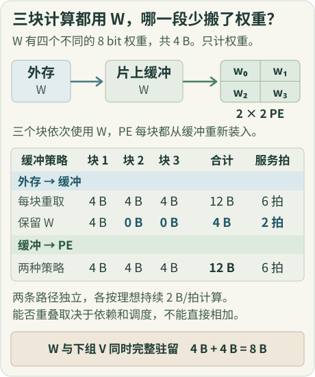

# NPU 连算三个块，为什么外存只读 4 B 权重，阵列却要接收 12 B？

假设在一颗 NPU 上放两个只数权重字节的计数器。一个守在外存通往片上缓冲的入口，另一个守在缓冲通往计算阵列的出口。连续算完三个块，第一个显示 **4 B**，第二个显示 **12 B**。如果两个计数器都没错，多出来的 8 B 是从哪里来的？

等第二个块刚要开始时停住机器。外存里的四个权重没变，片上缓冲还留着它们。阵列里的四个计算单元却要按这台机器的约定重新装一遍权重。此刻，阵列可以从片上取数，外存接口一次也不用动。下面先走完一个块，再回到这个时刻，逐笔复算两个读数。

## 四个权重怎样算出一个块？ {#tile}

把四个处理单元（PE）排成两行两列。每个 PE 自己做乘加：把输入的激活值乘以本地权重，再把乘积加到自己的部分和上。四个 **8 bit** 权重各占 1 B，每个 PE 放一个，整组取名 **W**。一块输入（tile）要算四拍。权重在这四拍里保持原值，激活每拍更换，每个 PE 的 **32 bit** 部分和从零开始。

举个能心算的例子。左上角存权重 2，右上角存权重 3。让第一行连续四拍收到激活 **1、2、3、4**。左上角的部分和依次变为 2、6、12、20，右上角最后得到 30。比如第三拍只从激活源读出一个 3，第一行的两个 PE 都收到这个 3，分别算 3×2 和 3×3。这叫**行广播**。第二行同时接收自己的激活，做相同形式的计算。

用行号 r、列号 c 和拍号 t 表示，每个 PE 算的是 <strong>Sr,c = ∑t=0..3 ar,t × wr,c</strong>。一次乘和一次累加合称一次 MAC。这里假定结果可由 32 bit 表示，部分和在四拍内都留在 PE，最后才送出。这是为追踪搬运而选的流式计算，实际矩阵乘怎样沿归约维度换权重，要按自己的映射来数。

| 先只算一个块 | 数量从哪里来 |
| --- | --- |
| 运算 | 4 个 PE 各算 4 拍，共 **16 次 MAC**。 |
| 权重 | 开算前给 4 个 PE 各装 1 B，共 **4 B**。随后四个计算拍内，权重入口的新增流量为 **0 B**。 |
| 激活 | 两行每拍各取 1 B，源端合计 **8 B**。每行广播给两个 PE，接收端合计收到 **16 B**。 |
| 结果 | 每个 PE 送出一个 32 bit 结果，共 **16 B**。中途没有部分和写回。 |

只看左上角那个 2 就能分清“用”和“搬”：它一共参加了四次乘法，却只在块开始前经过一次阵列入口。接下来给阵列三个不同的激活块，它们都用同一个 W。

## 权重缓冲在谁和谁之间？ {#paths}

外存先保存一份 W。搬运引擎把 W 复制进片上 SRAM 的一段空间，这段空间就是本例的**权重缓冲**。再由 SRAM 的读口和通往阵列的线路，把四个权重送到各 PE 的本地寄存器。缓冲读出一个值时，只要原位置没有被覆盖，它就还在那里，之后还能再读。

激活从另一个源到每行的广播入口，部分和则留在各 PE 里，算完送到结果目的地。先假设这两条路径资源充足，也不把激活的上游填充或结果的后续搬运计入权重计数器。图中只画权重。上面两个箭头对应两个计数器，中间按计算块分列，最下面标的是两个完整权重块要同时占据的空间。

## 第二个块开工时，哪一个计数器会动？ {#traffic}

先给两种调度相同的起点：权重缓冲和 PE 起初都没有 W，每个块开算前都要向 PE 重新装入四个权重，各块使用相同的权重布局。只改变块与块之间是否在缓冲中保留 W。

- **每块都重取。** 块 1 先从外存取 4 B 到缓冲，再从缓冲取 4 B 到阵列。块 2、块 3 开始前，缓冲中的旧副本已经失效或被覆盖，各自再走这两步。
- **缓冲保留 W。** 块 1 仍走两步。块 2 开始时，阵列的装载操作照旧执行，但四个权重在缓冲中都找得到，只动第二个计数器。块 3 同理。少掉的是两次外存读取，以及与它们对应的两次缓冲写入。

| 三个块做完后 | 每块都从外存重取 | 缓冲保留 W，PE 每块重装 |
| --- | ---: | ---: |
| 外存 → 权重缓冲 | 4 + 4 + 4 = **12 B** | 4 + 0 + 0 = **4 B** |
| 权重缓冲 → 阵列入口 | 4 + 4 + 4 = **12 B** | 4 + 4 + 4 = **12 B** |
| 激活源 → 阵列广播入口 | **24 B** | **24 B** |
| PE → 结果目的地 | **48 B** | **48 B** |
| 阵列完成的乘加 | **48 次 MAC** | **48 次 MAC** |

表中数的是有效数据字节，假定没有压缩、对齐填充、额外 Cache 命中或重传。实际 DRAM 若按更大的突发取数，应按该接口真正传输的粒度另外记账。同一份数据通过两条不同的线，在两处都应该数一次。把两处相加，就不能再把和称为“外存读取量”。

**只改一个条件，试着预测第二个计数器。** 假设块 1 结束后，四个 PE 里的权重仍然有效，调度也允许直接拿它们算块 2 和块 3。此时外存仍只传 4 B，缓冲到阵列也只传最初的 **4 B**。三种调度算出的结果相同。想知道一句“权重被复用了”究竟省了哪次传输，要问副本留在**哪一侧**，下一次使用还需不需要越过这条边界。

## 累计传了 12 B，为什么 4 B 的缓冲就装得下？ {#residency}

现在不看计数器，看缓冲里的四个位置。把第一个权重从其中一个位置读给 PE 三次，三次读取都从同一个地址出发。**12 B** 是三次整组装载积累的传输量，**4 B** 是这一组在任意一个时刻占据的空间。

再增加一个要求：阵列尚未完成最后一次从缓冲加载 W，搬运引擎已经把下一组完整的 4 B 权重 V 预取进来了，而且 W 仍须完整保留。此时必须能同时放下 **W 的 4 B + V 的 4 B = 8 B**。如果可以等到 W 最后一次读出、数据已安全到达下游再填 V，一个 4 B 槽就能轮用，但这次不能提前把整组 V 放进去。若 W 已全部进入本地寄存器，什么时候能覆盖缓冲、什么时候能覆盖 PE 寄存器，也是两个不同的问题。

把例子放大。一块有 1,024 个 8 bit 权重，紧密存放占 **1,024 B**。连续用十次仍占 1,024 B。当前块和等大的下一块都要完整驻留时才需要 **2,048 B**。若每个权重占 b bit，每块有 n 个权重，并且只在整块末尾补到字节边界，理想数据量为 **⌈n × b / 8⌉ B**。逐行或逐块对齐、稀疏索引、压缩元数据都要按实际布局另算。

所以给权重缓冲定容量时，要列出从装入到最后一次可安全释放的区间，并在同一时刻数有多少物理字节同时在场。若激活与权重共享同一块 SRAM，还要加上当时占用它的激活。各自的峰值若出现在不同时间，分别求峰值再相加也会高估。模型的参数总量回答不了这几个时刻的问题。

## 装得下四个权重，能按时交到四个 PE 吗？ {#supply}

假设图中两条权重路径各有独立的服务资源。每条路径在获准服务并且没有停顿时，每拍最多交付 **2 B**。只统计这项权重负载，忽略突发开销。每次完整装入 4 B 至少占两个服务拍。

- 外存到缓冲：每块重取时要服务 12 B，至少 **6 拍**。缓冲保留 W 时只服务 4 B，至少 **2 拍**。
- 缓冲到阵列：在每块都重装的前提下，两种调度都要服务 12 B，所以都至少要 **6 拍**。

回到图右上角。假设每拍能从缓冲读出两个不同的 8 bit 权重，阵列从顶部接收它们，已有的一行在下一拍向下移。为了让图里的 w₂、w₃ 最后落在底行，第一拍先送 w₂、w₃，第二拍再送属于顶行的 w₀、w₁。第二拍结束，两行都就位。这是一个能达到两拍的具体接线和供数安排。计算微架构篇沿相同的装载规则追到每一行，并单独讨论换下一块时寄存器会不会被覆盖。[2×2 阵列的装载与驻留](../../../microarchitecture/04-parallel-execution/why-systolic-array.md#流量时间和实现成本分别统计) · [权重怎样逐拍进入阵列](../../../microarchitecture/04-parallel-execution/weight-loading-and-trickle-feed.md#机制与接口)

再假设 w₂、w₃ 落在同一个每拍只能读一个字节的 bank，即使另一个 bank 空闲，也凑不齐第一拍要送的这两个数。没有额外暂存或重排时，就得改装载日程。反过来，两个 PE 若要的是**同一个**权重，支持广播的线路可以只从 SRAM 读一次、在下游投递两份。本例每个 PE 装的是各自的权重，行广播只用于激活，表里的 12 B 没用上这种权重广播。

外面占 2 拍、里面占 6 拍，整个任务就耗时 8 拍吗？先看首块：它需要的权重还没到达缓冲，阵列就不能装这些数。再看后面，两条独立路径是否能同时服务，还取决于什么数据已就绪、两端能否同时读写。三个计算块本身就有 **3 × 4 = 12 个阵列计算拍**，结果还要送出。单条路径的服务拍数只能说明它承担的工作量；总时间要把首块、依赖、可重叠阶段以及末块输出放到同一条时间线上。[激活缓冲如何给搬运和计算分配端口](./activation-buffer-and-double-buffering.md#input-ports) · [片上带宽预算](./on-chip-bandwidth-budget.md)

## 把 W 放在局部 SRAM，还是让多个计算簇共享？ {#shared}

对一个计算簇，本例只需一份 4 B 的 W。若两个簇各有私有缓冲，并且都要留住 W，两个缓冲各占 4 B，片上共有 8 B 的物理副本。若两个簇改读一个共享缓冲，只存一份即可。此时双方若同拍取不同权重，先看一次能读多宽。两个权重若在同一个宽字里，一个读口就可能一并取出，再分别送到两簇。若落在不同的字地址，还要看这些地址能否由不同 bank 或多个读口同时服务，以及分发线路能否在该拍把数送到。共享副本节省的容量，并没有替它们预订同一拍的读机会。

读芯片框图时，遇到 L0、L1、L2 可以依次问：谁能访问这块存储，谁决定装入和驱逐，存的是权重、激活还是部分和，以及哪一拍可以从哪个端口读写。有的副本由 Cache 自动管理，有的片上空间由编译器、软件或硬件调度显式管理。名称相同的层级可以承担不同的职责。外层也可以按容量、吞吐、功耗与封装选择 HBM、LPDDR 或 DDR。若考虑基于 NAND 的 HBF，还需要在放置、预取、写入寿命和软件管理上另作安排。[Cache 与 scratchpad](../02-access-paths/cache-vs-scratchpad.md) · [HBF 的工作负载与建模](../../05-hbf/07-workload-and-modeling.md)

## 少读 8 B，运行时间和能耗会怎样变化？ {#energy}

从外存的计数器可以确定，第二种调度比第一种少读 8 B，在图示带宽下所需外存服务拍数的下界从 6 拍降为 2 拍。但若这些传输原本就与计算重叠，整个任务未必会提前四拍结束。反过来，只换成双缓冲也可能提早完成，而传输字节一项都没少。若输入和输出共用物理端口，应在**那个资源**上合计方向和数量：片上带宽预算那篇的 HBM 例子每块读 100 B、写 100 B，同一控制器合计 100 B/拍，两块至少占四个服务拍。这是另一组参数与观察边界。[HBM 控制器服务拍与任务完成时间](./on-chip-bandwidth-budget.md#hbm-shared-read-write-budget)

能耗也要分开算。缓冲保留 W 后，可以少做两次外存读取和两次缓冲填入，缓冲向 PE 的三次读出以及 48 次 MAC 仍然存在。应当按实际的读、写、链路传输和计算活动，乘以相同工作点下相应的单位能量。若一次搬运的单位能量已经包含了源端读和目的端写，就别再把它们算第二遍。还要计入执行期间的静态能量，以及为保留 W 而挤出其他数据后带来的搬运。没有这些参数，能确定的是省了哪些活动，还不能报出整颗芯片的节能比例。[Eyeriss 论文，第 VI 节对不同层级数据活动的核算](https://eems.mit.edu/wp-content/uploads/2016/04/eyeriss_isca_2016.pdf)

## 在真实 NPU 里，沿权重这条线会走到哪里？ {#implementations}

看第一代 Google TPU 的框图。沿权重走，起点是片外 Weight Memory，经过片上 Weight FIFO，进入矩阵单元。沿激活和中间结果走，则能看到另一条路：24 MiB 的 Unified Buffer 向矩阵单元供输入，矩阵结果进入 4 MiB 的 32 bit 累加器，再经后续处理。主机内存与 Unified Buffer 之间还有 DMA。若把所有输入都算作 Unified Buffer 的读取，就会把权重的来源记错。[第一代 TPU 原论文，第 2 节图 1](https://arxiv.org/pdf/1704.04760#page=3)

再看 NVDLA v1。卷积缓冲 CBUF 把 16 个 32 KiB 的 bank 按配置分给输入数据、权重和压缩权重的辅助信息 WMB。未压缩时，16 个 bank 都可供输入和权重分配。启用压缩时，bank 15 留给 WMB。这里能在文档中看到多个逻辑缓冲，做容量和端口预算时却要回到那组物理 bank，核对各自的分配。这两种芯片可以用同样的问题分析，不能照抄同一张数据路径图。[NVDLA v1 卷积缓冲说明](https://nvdla.org/hw/v1/ias/unit_description.html#convolution-buffer) · [NPU 中的 SRAM 数据角色](../../02-sram/applications/npu-weight-buffer-activation-buffer.md)

## 在模型里怎样复现两个计数器的读数？ {#model}

给 W 记一条装入记录：哪一组数据、从哪里来、进哪个物理槽、何时对哪个消费者可见。每次真正传输时，在经过的资源和方向上增加相应字节；每个块记录何时装满 PE、何时最后一次使用 W，以及槽何时可以覆盖。按时间查看槽中还留着哪些块，得到容量峰值。按接口累计交付量，得到传输字节。按实际获准使用的 bank 和端口记录服务与等待，再结合计算依赖，才得到日程。不同资源上同时发生的等待只在总时间线上经过一次。[局部性与工作集](../01-system-basics/locality-working-set-data-movement.md) · [区分存储与计算瓶颈](../03-performance/memory-bound-vs-compute-bound.md)

可以拿一次最小改动检查模型。只将缓冲容量从 4 B 改为 8 B，仍只用 W，保持原来的“缓冲保留、PE 重装”调度。**外存应当仍读 4 B，阵列仍接收 12 B。** 多出来的是可用空间。只有真的安排 V 提前进入、让它与 W 的驻留时间重叠，才会出现 8 B 的峰值占用。

## 接下来怎么读？ {#next}

现在给下一块留出了一个槽。当前块还在计算，它是否真的能开始填充？沿着两块输入、两个输出和同一个 SRAM 口看时间线，再去核对一个端口一拍能交付几字节。[激活缓冲与双缓冲](./activation-buffer-and-double-buffering.md#input-ports) · [计算侧的两个分块日程](../../../microarchitecture/06-task-control/dma-compute-writeback.md#同样两个-buffer为何仍可能无法重叠) · [片上带宽预算](./on-chip-bandwidth-budget.md) · [NPU 数据路径与存储组织](./README.md) · [存储层次与系统角色](../01-system-basics/memory-hierarchy-as-system.md)
