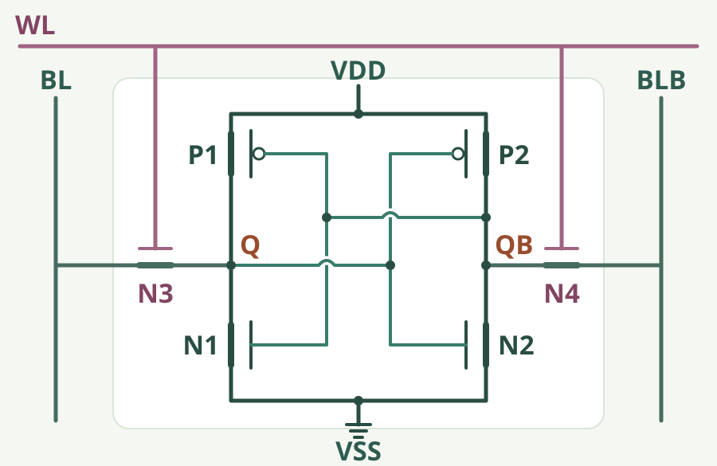

# 6T SRAM 怎样读出一个 bit，又怎样把它改写？

给同一个 SRAM 单元做三次访问。它已经存着 1。第一次读，得到 1。第二次写，把它改成 0。第三次再读，得到 0。如果只看控制单元的那根字线，三次都是拉高，再拉低。同一对开关打开，为什么第一次能读到旧值，第二次却能推翻旧值？最后一次读，又怎样证明单元真的记住了 0？

拿下面这个最常见的六晶体管（6T）单元做实验。先认出存数据的两个点，再盯着同一对位线，看看究竟是谁在改变谁的电压。

## 六只管子里，哪四只保存状态？ {#cell}

从左半边的 **Q** 开始读图。Q 是一小段导线，电压接近电源 VDD 时，本文记作 1，接近低电位 VSS 时记作 0。Q 上方的 P1 能把它接向 VDD，下方的 N1 能把它接向 VSS。这两只管子的栅极接在一起，由右边的 **QB** 控制。QB 低时，P1 导通、N1 关闭，Q 被拉高。QB 高时恰好相反，Q 被拉低。这就是一个反相器。[从 MOS 管到逻辑门](../../../semiconductor-foundations/cmos-logic-gates/README.md)

右半边也这样读。不同之处在于，右边两只管子的栅极接回了左边的 Q。沿着两根交叉的线走一圈，就能看见一个闭环。黑点表示相接，带跨线弧的交叉处彼此绝缘。

| 在图中找 | 沿着这段连接看什么 |
| --- | --- |
| 左反相器 P1、N1 | QB 控制它们，输出 Q。 |
| 右反相器 P2、N2 | Q 控制它们，输出 QB。 |
| 访问管 N3、N4 | N3 接在 BL 与 Q 之间，N4 接在 BLB 与 QB 之间。两只都是 nMOS，共用一根字线 WL。 |
| 两根位线 BL、BLB | 这两根线伸出单元，通向预充电路、读出放大器和写驱动。那些电路在六只管子以外。 |

Q 和 QB 是节点名。这里用 Q 代表所存的 bit。稳定时 QB 与 Q 取相反的逻辑值，所以这一对节点合起来存一个 bit。BLB 的 B 也表示它是配对的另一根位线，但两根位线的瞬时电压取决于外围怎样驱动。马上会看到，读之前它们可以**同时为高**。图中省略了晶体管体端和导线的寄生电容，实际电压会随时间连续变化。

## 放开位线以后，1 靠什么留下来？ {#hold}

设先前已经写过 1，此刻 Q 高、QB 低。把 WL 拉低，关掉 N3、N4。两根位线随即与单元隔开。先用手遮住图中两侧的位线，只沿中间四只管子走一圈。

1. 从低的 QB 出发。它让 P1 导通、N1 关闭，因此左边有一条从 VDD 到 Q 的上拉路径，维持 Q 高。
2. 从这个高的 Q 往右走。它让 P2 关闭、N2 导通，因此右边有一条从 QB 到 VSS 的下拉路径，维持 QB 低。现在又回到了出发时的条件。

假如少许电荷流入 QB，让它略微升高，只要 Q 仍足够高，N2 就仍能把这部分电荷泄向 VSS，低电平可以恢复。把高低完全对调也能走通一圈，此时导通的换成 P2 和 N1。这便是**双稳态**。两个状态都能靠电源和反馈维持，小扰动过去后可以回到原状态。后面的写操作要做到的，正是把节点推到会向另一种状态发展的地方。

SRAM 名字里的「静态」，指它在满足供电、温度和噪声条件时可以这样持续保存数据，无须定期刷新。断电后，上拉路径失去了电源，重新上电时也无法仅凭这张图预知 Q 会取哪一个值。这里从 1 开始，是因为我们事先写过 1。实际芯片复位时是否清空 SRAM，要看宏的接口约定。[SRAM 宏接口与读写语义](./sram-macro-interface-and-semantics.md)

## 第一次读，为什么 BLB 下降，原本为低的 QB 反而升高？ {#read}

**先让两条位线从同一高度出发。** 此刻 WL 仍低。外围把 BL、BLB 都充到接近 VDD，并使两者电压接近，这分别叫预充和均衡。随后撤掉预充和均衡。导线有电容，电源通路断开后，已充入的电荷仍能让两根位线暂时保持高电平。接下来，两条线中哪一条先失去电荷，就取决于选中的单元。这里采用读前高电平预充的差分方案。

**现在拉高 WL。** 选通了两只访问管，但两侧的初始条件不同。左边的 BL 和 Q 本来都高，几乎没有驱动放电的压差。右边的 BLB 高、QB 低，且 N2 正被高 Q 打开。读图时把手指放在 BLB 上，沿常规放电电流的方向走：

**BLB → N4 → QB → N2 → VSS。**

为什么一条路径上能同时看到两个相反的电压变化？BLB 上的电荷流出，位线电压自然下降。再看路径中间的 QB。刚选通时，N4 从高位线往这个低节点送入电流。真实的 N2 导通时仍有电阻，QB 也有电容。最初流入 QB 的电流大于经 N2 流出的部分，QB 上就积起一点电荷，电压随之升高。QB 被抬高后，N2 的漏源压差增大，可以泄走更多电流。成功读取时，这个抬升足够小，单元始终留在原状态可以恢复的范围内。

把演示推进到字线升高的那一步，同时看 BLB 和 QB。两者在 N4 两端，有导电通路，也可以有压差。演示标的是电压变化的方向，各步时长和高亮线条均为示意。

<!-- sram-read-demo -->

**外面怎样知道里面存着 1？** 等 BLB 比 BL 低了一点，列外围的读出放大器（sense amplifier）比较两条位线，把这个小差值放大成数字结果。在本文的接线里，BL 高于 BLB 对应 Q = 1。只要差值足以压过放大器自身的偏差和当时的噪声，并在合适的时刻启动感测，就能读到 1，无须等 BLB 一直降到 0。

读完关掉 WL，高位线向 QB 注入电流的路径消失。Q 还高，N2 仍开着，QB 就回到原来的低电平。这个恢复由单元自身完成。在 1T1C DRAM 中，单元电容与位线共享电荷后，则要由感测放大器把电平恢复并写回电容。[对照 DRAM 的感测与恢复](../../03-dram/foundations/1t1c-cell-destructive-read.md#sense-restore)

这里可以分清两种读失败。如果太早启动放大器，位线差值还很小，**输出可能判错，单元仍存着 1**。如果高位线把 QB 抬得太高，左反相器会降低 Q，右反相器又会进一步抬高 QB，**单元本身可能翻成 0**。正常读也会让 QB 短暂偏移，这叫读扰动。只有扰动发展到翻转，才丢了原数据。

## 写入 0，哪只管子先和写驱动较劲？ {#write}

第一次读结束，Q 仍高、QB 仍低。现在想写 0。先保持 WL 低，关闭预充路径。外围的**写驱动**把左边的 BL 拉到低电平，把右边的 BLB 拉到高电平，并在写入期间持续维持这一对电平。这时即使 BL 已经是 0，Q 也还是 1，因为 N3 还关着。位线上准备好的数值要等 WL 升高才能影响单元。

**抬高 WL，先盯住原本为高的 Q。** 低 BL 通过 N3 从 Q 抽走电荷。旧状态也在起作用。QB 此刻仍低，P1 仍把 VDD 接向 Q，一边抽走电荷，另一边试图补回。只要写驱动与 N3 这条路径能在竞争中把 Q 拉得足够低，右侧反相器便开始改变自己的输出。同时，高 BLB 经过 N4 帮助 QB 上升，原先导通的 N2 则仍在向下拉它。

**顺着闭环再走一圈。** Q 下降会使右侧的 P2 逐渐增强、N2 逐渐减弱，于是 QB 更容易上升。上升的 QB 又使左侧的 P1 减弱、N1 增强，推动 Q 进一步下降。起初，反馈在维持旧状态。随着两个电压越过两种稳定状态的分界，反馈会把这个变化放大，直至 Q 低、QB 高。这里分步追踪因果，电路里的两个电压在翻转期间可以同时变化，也不必时刻严格互补。

这个过程还解释了为什么单元里需要 P2。N4 是一只 nMOS，QB 越接近高电平，它的栅极 WL 与 QB 之间的电压差就越小，继续往上拉的能力随之减弱。Q 变低后，P2 提供了一条从 VDD 到 QB 的上拉路径，让 QB 能接近完整的高电平。写入的最后一段，接手的是这对反相器。

<!-- sram-write-demo -->

**现在撤掉写驱动会怎样？** 等新状态建立，按这里的时序先拉低 WL，使位线与单元隔开。此时维持低 Q 的是 N1，维持高 QB 的是 P2。外围可以释放位线，新值会留下来。若把字线脉冲缩得过短，可能只看到 Q 下陷了一点，关掉访问管后它又弹回高电平。这是一次写失败。反过来写 1 时，将 BL 驱高、BLB 驱低，上述左右路径随之对调。具体宏怎样安排预充、驱动和字线相位，取决于它的外围控制电路。

## 再读一次，先下降的会是哪根位线？ {#read-again}

先用手遮住下表的最后一行。写 0 已经结束，两条位线都会重新预充到高电平。上一次写时留在位线上的差值已经消失。这一次重新拉高 WL，哪一侧还有通到 VSS 的路径？

| 对同一单元的访问 | 拉高 WL 时，外围怎样使用位线 | 单元内外能观察到什么 |
| --- | --- | --- |
| 第一次读，原值 1 | 两根线都预充为高，然后释放 | BLB 经 N4、QB、N2 放电。BL 较高，读出 1。 |
| 写 0 | 写驱动持续把 BL 拉低、把 BLB 拉高 | N3 先帮助拉低 Q，反馈随后建立 Q 低、QB 高的新状态。 |
| 再读，原值已为 0 | 两根线重新预充为高，然后释放 | **BL 经 N3、Q、N1 放电**。这回 BLB 较高，读出 0。 |

WL 在三次访问里做了相同的事。读时，外围给两根位线同样的起点，随后让单元在其中一根线上留下差值。写时，外围主动维持一个有方向的电压差，直到单元建立新状态。最后一次读把写驱动排除在外，仍能得到 0，才说明新值保存在单元里。

## 为什么访问管不能一味做强？ {#margin}

回到第一次读的右半边。若 N4 相对 N2 更强，预充的 BLB 就更容易抬高 QB，读扰动可能变大。再看写 0 的左半边。若 N3 与写驱动相对于 P1 太弱，又很难把 Q 拉下来。在左右对称的设计里，同时增强两只访问管，可能让写入更容易，却压缩读取时的稳定裕量。**读要看低节点的访问管与下拉管，写要看高节点的访问路径与上拉管。** 两次较劲发生的位置不同。

设计者常用 **cell ratio** 描述下拉管相对访问管的强度，在第一次读中就是比较 N2 与 N4。它能解释变化趋势。要判断一颗实际芯片，仍要知道各管在当时端电压下能提供多少电流，以及位线和节点电容、字线脉宽、供电、工艺、温度、噪声和器件失配。没有一个通用强度比、也没有一个固定的半电源电压能替所有单元划定翻转边界。

| 要验证的问题 | 应当怎样看 |
| --- | --- |
| 待机时能承受多大扰动？ | 在 WL 低的保持偏置下评估保持静态噪声裕量（hold SNM）。它衡量规定模型下可持续施加多大的直流噪声，单元仍能保持状态。 |
| 选中读取后还能稳住吗？ | 在 WL 高和指定位线电压下评估读静态噪声裕量（read SNM）。读偏置改变了低节点的工作点。实际读还要检查扰动持续时间、位线差分和感测时机。 |
| 写入能在规定时间完成吗？ | 给定驱动、电压和字线脉宽，检查撤去驱动后能否保持新值。比较不同电路的写裕量或写入时间时，要先确认测量定义和工作条件一致。 |

静态裕量回答的是规定偏置下的稳定性。一段有限宽度的脉冲能否写进去，仍需用目标电路及其寄生参数做动态仿真，或用实测数据核对。[动态读写稳定性的实测研究](https://people.eecs.berkeley.edu/~bora/Journals/2011/JSSC11-11Seng.pdf)

## 接下来怎么读？

**把图里的单元复制成 64 行 × 16 列，再把同一行的访问管都接到一根 WL 上。** 拉高一根字线，就会同时选中 16 个单元。如果 SRAM 的接口一次只输出 4 bit，其余 12 列去了哪里？下一篇沿这次读访问，走过行译码、共享位线、列选择和读出放大器。[字线、位线与读出放大器](./wordline-bitline-sense-amp.md)

再往上看，架构模型通常从选定的 SRAM 宏及工作点取读写延迟、端口接纳间隔、冲突规则和每次访问能量。模型要确定输入在哪个边沿采样、输出何时可见，以及下一次访问何时可以进入。能维持反馈的最低供电电压，也要与能按规定时序完成读写的电压分别确认。这些参数需要整条阵列路径的数据，单个 6T 电路图给不出答案。[SRAM 读写时序](./read-write-cycle-timing.md) · [SRAM 宏接口与读写语义](./sram-macro-interface-and-semantics.md) · [MIT 的 SRAM 阵列讲义](https://ocw.mit.edu/courses/6-004-computation-structures-spring-2017/pages/c14/c14s1/)

## 延伸阅读

- 讲义选了相反的初始值。把本文电路的左右两侧对调，再沿讲义中的读写路径走一遍，可以核对下拉管、访问管和上拉管何时起作用。两图的晶体管编号也各自独立。[David Harris，SRAM，第 7–9 页](https://pages.hmc.edu/harris/class/e158/lect15-sram.pdf#page=7)
- 位线上的小差分要经过真实的感测电路，耦合噪声、供电变化和器件差异都会影响可用裕量。[Stanford EE371，RAM 稳定性与噪声](https://web.stanford.edu/class/archive/ee/ee371/ee371.1066/lectures/Old/lect_10_2up.pdf#page=14)
- 想看一套具体的宏怎样安排预充、感测使能和写驱动，可以对照这个开源实现的控制信号。[OpenRAM 控制时序](https://github.com/VLSIDA/OpenRAM/blob/stable/docs/source/control_logic.md)
