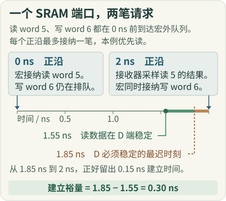

# SRAM 在哪一拍接纳请求，读数据又在哪一拍可用？

上升沿快到了。处理器要读 SRAM 的字 5，搬运数据的 DMA 同时要写字 6，这里的字地址从 0 编号。两个地址都在范围内，也没有人要改对方的数据。如果这块 SRAM 只有一个读写端口，谁能在这个上升沿把地址送进去？到下一个上升沿，读数据和等待的写请求又分别到了哪里？

先看三组信号：宏的地址与片选、读写控制引脚，接收寄存器的数据输入 D，以及时钟。沿同一个例子看，会看见三件可以分别发生的事：**宏采样一笔请求，数据沿导线到达 D，接收寄存器在边沿把它收下。** 上一篇追到的四个感放位于宏内部，这次从宏的引脚向两边看。[回看字线、位线与感放怎样选出一个字](./wordline-bitline-sense-amp.md)

## 一个端口为什么不能同时读字 5、写字 6？ {#macro-pins}

SRAM 宏是一块可以接进芯片的存储模块。先看一套真实的引脚。SRAM22 的 `sram22_64x32m4w8` 有 64 个字，每个字 32 bit，数据容量 **64 × 32 / 8 = 256 B**。它有一组 6 位字地址 `addr`，用一个 `we` 区分读写。这就是 **1RW**：一个端口，接纳一次操作时可以读，也可以写。[SRAM22 引脚表](https://sram22.com/docs/interface/pin-list/)

| 在这个宏上观察什么 | 满足供电、复位释放和输入时序时，上升沿会怎样 |
| --- | --- |
| `ce=1, we=0, addr=5` | 采样读地址。经过时钟到输出的延迟，`dout` 给出字 5 的内容。 |
| `ce=1, we=1, addr=6` | 采样写地址、`din` 和 `wmask`，写入掩码允许的位组。 |
| `ce=0` | 这次没有新访问。已有存储内容和读输出保持原状。 |

为什么地址不同也会冲突？在同一个边沿，六根地址线只能给出一个二进制数，`we` 也只能取一个值。即使阵列里还有许多空字，也无从在这组引脚上同时表示这两笔操作。下面给宏外加一层控制逻辑（wrapper）：它能暂存等候的请求，本例约定两笔同时到达时先发读。读优先是这层控制逻辑的选择。

### 处理器给的是字节地址，引脚上应该放什么？ {#word-address}

上一篇的小阵列用一个地址选 4 bit。这里换成 32 bit 字，一个字占 4 B。设这块宏映射到系统字节地址 B，B 按 4 B 对齐，连续四个字节映射到一个字，期间没有交错或重排。对范围内的字节地址 A，把 **A − B 除以 4，商是宏字地址，余数是字内字节偏移**。

因此 B + `0x14` 和 B + `0x16` 都落在字 5，分别是其中偏移 0 和 2 的字节。若处理器从 B + `0x14` 读完整的字，总线上送给宏的是 `addr=5`。DMA 要更新的字从 B + `0x18` 起，送的是 `addr=6`，具体更新哪些字节由写掩码决定。若只写其中一个字节，偏移还得经系统的字节序和接线映射到掩码。越界、非对齐或跨字操作如何拆分或报错，要看系统接口。

## 跟着这笔读走过 0 ns 和 2 ns 两个边沿 {#timeline}

为便于手算，以下使用**假设的同步 1RW 宏**。借用上面的引脚含义，单独假设它在这个工作点每 2 ns 可以接纳一笔读或写，也允许相邻两拍先读后写。宏和接收寄存器同一时钟域。图中的电路延迟和周期都是教学数值。要查 SRAM22 实例的实际时序，需要看它在相应工作条件下的时序库。[SRAM22 时序示例](https://sram22.com/docs/interface/timing/)

**0 ns，看地址引脚。** 两笔请求都已到达 wrapper。它在这个沿之前就选好了读，让地址 5、片选和读控制满足宏的建立时间，并在沿后满足保持时间。宏在上升沿采样了读请求。写地址 6 仍在等待。此时若去看 `dout`，引脚上即使恰有一个完整的数，也还不能把它交给这笔新读。

**1.55 ns，把探头移到接收寄存器的 D 端。** 假设字 5 原先存着 `0x55667788`。宏内部完成读取，读结果从 `dout` 经过连接线，到 **1.55 ns** 在 D 端稳定。现在导线上已经有了这个数，接收寄存器还在等时钟沿。这里的 1.55 ns 包含了宏和连接路径，两处探头看到新值的时间可以不同。

**2 ns，两件事同时发生。** 接收寄存器采下 `0x55667788`。与此同时，wrapper 此前已把地址换成 6，并准备好写数据、掩码和写使能，宏在同一个沿接纳这笔写。一个边沿可以让两个不同的寄存器各自采样输入。宏这次依然只接纳了一笔新操作，读字 5 是上一个沿发起的。

读数据提前多久到达才来得及？设接收器要求 D 在采样前至少稳定 **0.15 ns**，时钟偏斜和抖动已计入本例边界。最晚到达时间为 **2.00 − 0.15 = 1.85 ns**，实际到达为 1.55 ns，因此**建立裕量为 0.30 ns**。只改变一个条件：若 D 到 1.90 ns 才稳定，虽然看起来仍赶在 2 ns 之前，却只留下 0.10 ns，已不能保证这次采样正确。沿后还要满足保持时间，这要沿最快的数据变化另算。

### 这 1.55 ns 里，阵列在做什么？ {#electrical}

沿用上一篇的差分读。控制电路准备位线，地址译码决定行和列。字线接通单元后，一侧位线开始放电，积累足够差分，感放才可以判决并驱动输出。读得对还要求单元自己经受住读扰动。写时则由写驱动施加目标电平，使被选单元建立并保持目标值。只有目标值与原值不同时，单元才需要翻转。各阶段有先决条件，部分译码与位线准备可以并行，列选择位于感测前还是后也取决于实现。

可以对照 OpenRAM 的一种控制安排：正沿采样地址和输入，高电平阶段安排采样、预充与译码，低电平阶段执行读或写，读结果在负沿之后、下个正沿之前可用。这里有具体的相位分工，不能据此给别的宏指定半拍延迟。DRAM 的控制器则可能要从外部显式发出开行、读写和预充命令，接口暴露的边界不同。[OpenRAM 控制时序](https://github.com/VLSIDA/OpenRAM/blob/stable/docs/source/control_logic.md#external-control-signals) · [DRAM 命令与首个数据](../../03-dram/protocols/commands-act-rd-wr-pre.md)

### 如果结果要两拍才能收下，第二笔读要等两拍吗？ {#pipeline}

把请求改成连续两笔读 A、B，换一个带流水级的宏。设它承诺**每拍接纳一笔读**，每笔结果在发起后的**第二个上升沿**被下游寄存器采样。把接纳和接收分成两列，就能看清两笔请求如何交错。

| 上升沿 | 宏接纳新请求 | 下游采样本例的读结果 |
| --- | --- | --- |
| n | 读 A | — |
| n+1 | 读 B | — |
| n+2 | 还可以接纳后续请求 | A |
| n+3 | 还可以接纳后续请求 | B |

从接纳到接收，A 走了两拍。从接纳 A 到可以接纳 B，只隔一拍。这分别是按上述边界定义的**读延迟**和**接纳间隔**。若某个宏必须等上笔操作结束才能再次驱动位线，间隔也可能变长。单凭容量、位宽、时钟频率或“一拍 SRAM”的说法，算不出这两个数。

### 换了器件，该从哪里重新量？ {#timing-checks}

对于同步宏，要先确认时序库以哪个时钟沿为参考，再核对输入建立和保持时间、时钟高低脉宽、最小周期，以及从相应时钟沿到输出的最大和最小延迟。最大路径关系到接收端的建立时间，最小路径关系到保持时间。工艺、电压、温度、输入信号变化快慢及输出负载都会改变这些参数。OpenRAM 的表征流程会为指定配置与工作角生成时序和功耗数据。[OpenRAM 表征说明](https://github.com/VLSIDA/OpenRAM/blob/stable/docs/source/characterization.md)

再看异步 SRAM，例如 Alliance Memory AS6C62256。它没有上述采样地址的宏时钟沿。一次读要从地址稳定、片选有效、输出使能有效等各自的起点查对应访问时间，并满足最小读周期。接收端若用寄存器，仍要检查数据能否在自己的采样沿前后保持稳定。[AS6C62256 数据手册，读时序表与波形](https://www.alliancememory.com/wp-content/uploads/AS6C62256-23-March-2016-rev1.2.pdf#page=5)

## 回到 2 ns，那笔写究竟改变了什么？ {#write-mask}

设字 6 原来的值为 `0x11223344`。刚才在 2 ns 被接纳的写带着 `din=0xAABBCCDD`、`wmask=0101`。按这个 32 位、每组 8 位的接口，掩码位 0 控制数据位 [7:0]，位 1 控制 [15:8]，依此类推。把字按数据位从高到低排开就能算出结果。

| 按数据位从高到低 | [31:24] | [23:16] | [15:8] | [7:0] |
| --- | --- | --- | --- | --- |
| 旧字 | 11 | 22 | 33 | 44 |
| 输入数据 | AA | BB | CC | DD |
| 掩码位 | 0，保留 | 1，写入 | 0，保留 | 1，写入 |
| 生效后的字 | **11** | **BB** | **33** | **DD** |

写入生效后，字 6 应为 **`0x11BB33DD`**。这些十六进制数按数据位编号排列，与系统如何给字节编址是两个问题。写被接纳、单元完成翻转、上游收到完成通知也可以有不同时间。若目标契约保证接下来一拍就能接纳对字 6 的读，且该读能看到这次写，那么在 4 ns 发起读回，结果应为这个新值。一次读回能检查写入的可见性。它给不出单元究竟在哪个瞬间翻转，宏也未必有写完成引脚。

### 没有合适的写掩码，为什么会丢掉别人的更新？ {#read-modify-write}

换一块只支持整字写入的 1RW 宏。若只想改一个字节，wrapper 可以先读整个字，替换目标字节，再把整个字写回，这叫**读改写**。仍从 `0x11223344` 出发，按数据位从低到高把字节编号为 0 至 3。A 想把字节 0 改成 AA，B 想把字节 1 改成 BB。

| 单口依次接纳的操作 | 读到了什么，或写回了什么 |
| --- | --- |
| A 读，随后 B 读 | 两者都读到旧字 `0x11223344`，各保存一份。 |
| B 先写回 | 字变为 `0x1122BB44`。 |
| A 再用自己的旧副本写回 | 字变为 `0x112233AA`，字节 1 又成了 33。 |

每次宏访问都已排好队，却丢了 B 的更新。若两笔逻辑修改都保留，结果应是 **`0x1122BBAA`**。一种修法是对这个字做互斥，让保护覆盖读、合并和写回，直到更新按约定对后续访问可见，再让冲突方读取。所有能写入该范围的路径都要遵守这条规则。

保护多大范围取决于实际重写的单位。例如 TI TMS470M 的 eSRAM 在相应 ECC 配置下按 64 位数据维护校验。一次窄写可能需要由 wrapper 读出整个受保护数据块，合并修改并重算校验后写回。此时两个请求即使改不同的字节，也可能共用需要保护的 ECC 字。[TI TMS470M 技术参考手册，§5.5.1 读改写](https://www.ti.com/lit/ug/spnu495c/spnu495c.pdf)

## 若增加一个端口，哪一种等待会消失？ {#ports}

回到开头。只把 1RW 换成一个允许同时读写不同地址的 **1R1W** 宏，且 wrapper 也能在同一沿递交两笔请求。现在读口可以接地址 5，写口可以接地址 6。那一拍争用同一组引脚的等待就消失了。两者的读延迟、写入可见时间仍要按各自的契约计算。

| 常见端口标记 | 可以向哪些口发操作 |
| --- | --- |
| 1RW | 一个可读写口，一次选读或写。 |
| 1R1W | 一个只读口，一个只写口。 |
| 1RW1R | 一个可读写口加一个只读口，两个口都能用于读。 |
| 2RW | 两个可读写口，每个口各自选读或写。 |

### 把两个地址改成同一个，还能预测读到什么吗？ {#collision}

若读口和写口都访问字 5，就从端口争用变成了**同地址碰撞**。要查器件是否允许这个组合，以及在该模式下读口会给旧值、新值、未定义输出，还是要求上游错开操作。不同宏或外部转发逻辑可以给出不同保证。读口这次输出无效，与存储内容本身被破坏，也是两种不同后果。

一个具体对照是 AMD 的双口嵌入式 RAM。对于文档所述的同步跨口写读，写端配置为 READ_FIRST 时，另一端可读到旧值。写端配置为 WRITE_FIRST 或 NO_CHANGE 时，对面读口上被写字节的输出无效，写入本身仍然生效。两个写口若同时修改地址中重叠的字节，还要单查存储内容是否有定义。[AMD PG326，双端口碰撞行为](https://docs.amd.com/r/en-US/pg326-embedded-memory-generator/Collision-Behavior)

若两端口用独立时钟，不能只找波形上完全重合的边沿。举个教学例子：如果目标器件要求同址读写两沿至少相隔 0.3 ns，一次在 5.0 ns，另一次在 5.1 ns，实际只隔 0.1 ns，已经落入禁用窗口。0.3 ns 是这个算例的假设，真实窗口要查器件规格。若宏不保证所需行为，wrapper 必须避免该组合，或用经过验证的仲裁、等待或转发给出系统需要的结果。

## 总线上一直有数，怎样认出这是一次新响应？ {#wrapper}

把读数据线保持在 `0x55667788`，关闭片选一个周期。SRAM22 在空闲时会保持 `dout`，这一个周期并没有接纳读请求。反过来，连续读两个内容相同的字，数据线甚至可能完全不跳变，却有两次读响应。wrapper 因此要记住哪些读已经被接纳、何时应给哪一笔请求标记结果有效。如果下游能拒收，还要按系统协议缓存或推迟响应。类似地，有没有写完成应答、何时应答，取决于系统怎样封装宏。[ESP 的 SRAM wrapper 集成实例](https://esp.cs.columbia.edu/docs/asic_tech_integration/asic_tech_integration-guide/)

复位也是接口的一部分。以 SRAM22 为例，实体宏的 `rstb` 是低有效异步复位，会抑制访问并复位控制状态和输入触发器。存储内容与读输出并不会被这根线初始化。它的行为模型在时钟沿检查复位。系统若要求复位后读出全零，就要安排明确的初始化过程。换宏时还要核对保持供电、休眠唤醒和测试模式的访问规则。[SRAM22 的复位与引脚定义](https://sram22.com/docs/interface/pin-list/)

### 在架构模型里，需要记住哪几个时刻？ {#model}

重放开头的两笔请求即可检查模型。在 0 ns 只让读占用宏端口，把写留在等待队列。分别记录读结果到接收端的时间和接收沿，在 2 ns 释放接纳机会给写。以契约规定的边界安排写入可见和下一次读回。地址与掩码转换、队列、仲裁、响应标记或背压属于实际提供这些功能的那一级。若只想解释端口等待，经过表征的宏接口时序已经足够，无须把译码、预充、感测分别向上取整为一拍再相加。

还可以用上面的数直接检查模型：初始值加掩码写应读回 `0x11BB33DD`，正确保护的两个部分更新应保留 `0x1122BBAA`。再检查片选关闭和复位时有没有错误地产生响应，以及同址碰撞是否被按规格处理。这些检查验证接口功能。要知道一颗真实芯片的最快周期或单元噪声裕量，还得回到时序库、电路仿真与实测。

## 接下来怎么读？ {#next}

若想让开头那两笔请求更早进入，可以比较双口、复制和时分复用分别增加了哪些资源，再沿局部阵列、bank 地址映射查找仍然共用的路径。选一块宏接进系统时，可用选型清单核对容量、端口、时序和低功耗条件。[SRAM 端口与代价](./single-port-dual-port-multi-port.md) · [SRAM 阵列组织](./sram-array-organization.md) · [bank 地址映射与冲突](./sram-bank-address-mapping-conflicts.md) · [SRAM 选型清单](../../reading-and-reference/02-reference/sram-design-checklist.md) · [返回 SRAM 基础](./README.md)
