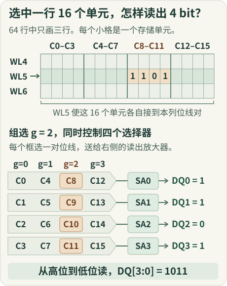

# SRAM 一根字线选中 16 个单元，为什么只读出 4 bit？

假设一块 SRAM 存着两个相邻的 4 bit 字。读地址 `0x16`，输出是 `1011`。再读 `0x17`，输出变成 `0010`。如果能在芯片里观察这两次访问，会看到一个有意思的现象：**两次拉高的都是同一根字线 WL5，两次接通的也是同一排 16 个单元。** 那么，第二个地址究竟改变了哪段电路？

上一篇的六管单元存着 1 时，读取会让 BLB 先下降，存着 0 时，会让 BL 先下降。现在把这样的单元排成 64 行、16 列。先沿第一笔读走到输出，再只改地址的最低一位，看看哪段路径跟着变。[回看一个 6T 单元的放电路径](./6t-cell-bistable-storage.md)

## 一排有 16 个 bit，地址为什么只指向其中 4 个？ {#word-address}

行和列都从 0 编号。从左到右，把每行的 16 个单元分成四组相邻的列。每组 4 个 bit，合起来就是接口可以读写的一个**字**（word）。这里的地址按 4 bit 字编号，地址加一就前进一个字。这项约定很重要，如果拿处理器的字节地址直接代入，算到的会是另一个位置。

阵列的物理容量是 **64 × 16 = 1,024 bit = 128 B**。从接口看，同一块存储可以写作 **256 字 × 4 bit**。编号 0 到 255 需要 8 位地址。我们约定高 6 位选行、低 2 位选这一行里的第几组。于是，字地址等于「行号 × 4 + 组号」。具体 SRAM 可以采用不同的地址映射和列排列。

把 `0x16` 写成 8 位二进制 `000101 10`。前六位是 5，后两位是 2。行译码器据此选 WL5，列译码器选第 2 组，即 C8、C9、C10、C11。图中上半部分画物理位置，下半部分把四个读出放大器各自能接到的列展开。先沿 C8 走到 DQ0，再沿存着 0 的 C10 走到 DQ2。

## 拉高 WL5 的那一刻，其余 12 个单元在做什么？ {#row-select}

先把列选择遮住，只看图的上半部分。这个例子采用一根横贯整行的字线。WL5 接到这一行全部 16 个单元的访问管栅极。沿竖直方向看，每列都有自己的 BL、BLB 两根位线，由这一列的 64 个单元共享。一个单元有两只访问管，分别控制它的 Q、QB 能否接到这两根线上。

读前，外围把所有 16 对位线预充并均衡到接近电源电压，再释放预充。WL5 升高后，**这一行的 16 个单元各自接到本列的位线对**。同一列虽然还挂着另外 63 个单元，它们的字线保持低电平，访问管关闭。因而 C8 的放电方向由第 5 行的 C8 决定。第 5 行的 C9 也在放电，但它用的是另一对导线。

具体看两列。设第 5 行的 C8 存 1，内部 Q 高、QB 低，**BLB8** 经访问管和单元的下拉管向低电位放电，BL8 暂时较高。C10 存 0，两条路径反过来，先下降的是 **BL10**。两对线上都出现了可供判决的电压差，方向相反。其余 12 个本次不会输出的单元也能在各自的位线上留下差分。后面要做的，是决定让哪些差分到达放大器。

## 四个读出放大器怎样挑到正确的四对位线？ {#column-select}

看图中通向 SA0 的第一个选择器。SA 是读出放大器（sense amplifier）。每个输入都代表一对位线，选中时 BL、BLB 一起接过去。组号为 0、1、2、3 时，SA0 分别接 C0、C4、C8、C12。为什么每次跨四列？因为 SA0 只负责输出位 DQ0，它需要的是每个 4 bit 字的**第一个**单元。SA1 同理，只在 C1、C5、C9、C13 中选一个。

四个选择器共用同一个组号。组选 2 时，它们同时接通各自的第三个输入，恰好选到连续的四列。若按物理列号从小到大看，四个单元存着 **1、1、0、1**。分别经过 SA0、SA1、SA2、SA3，就得到 DQ0 = 1、DQ1 = 1、DQ2 = 0、DQ3 = 1。接口按高位到低位写作 **DQ[3:0] = 1011**。电路没有调换数据，只是书写顺序从 DQ3 开始。

剩下的 12 对位线到这里就止住了。即使它们的电压已经变化，也没有经过列选择接到这四个放大器。**一根字线决定哪些单元参与这次阵列活动，四个列选择器决定哪四对位线能影响本次输出。** 这种先选列再感测的组织让四个字分时共用感放。真实 SRAM 也可以先在局部感测再选输出，或只激活字线的一段。图里的数量和顺序对应本文选定的实现。[伯克利技术报告，图 2.1 的列选择器与感放](https://www2.eecs.berkeley.edu/Pubs/TechRpts/2018/Archive/EECS-2018-156.pdf#page=26)

当差分和使能时机满足读出电路的要求，sense amp 判决并输出数字结果。它不必等待较低位线降到完整的逻辑 0。预充位线也会扰动 cell 的低节点；**差分足够感测**和**cell 保持原值**是两个都需要满足的条件。单元内的具体路径见 [6T SRAM cell](./6t-cell-bistable-storage.md)。

普通读在一列里判决选中行的一个 bit。如果想让这列中两个存储位共同给出一个逻辑结果，读通路怎样改？换一种电路，各列又怎样通过电荷共享，把多项贡献汇成可测的电压差？[两个存储位怎样共同求值](../../../microarchitecture/08-in-memory-computing/02-memory-technologies/sram-cim-foundation.md) · [多列怎样通过电荷共享求和](../../../microarchitecture/08-in-memory-computing/02-memory-technologies/sram-cim-deep-dive.md)

SRAM 的读感测一般不承担常见 1T1C DRAM 开行时的电容恢复过程。两者的内部职责和接口规则不同，见 [DRAM 的感测与恢复](../../03-dram/foundations/1t1c-cell-destructive-read.md#sense-restore)。

## 只改地址的最低一位，会换哪段线路？ {#change-address}

现在结束第一次读，按本例的常规时序关字线、重新准备位线，再向同一接口送入 `0x17`。先别看表，用图中 DQ0 这一行猜一下：第二次读时，它的输入会从 C8 换到哪一列？

| 字地址 | 行号与组号 | 依次接到 SA0、SA1、SA2、SA3 的列 | 对应四列从左到右的存值 | 输出 DQ[3:0] |
| --- | --- | --- | --- | --- |
| `0x16`（22） | 行 5，组 2 | C8、C9、C10、C11 | 1、1、0、1 | `1011` |
| `0x17`（23） | 行 5，组 3 | C12、C13、C14、C15 | 0、1、0、0 | `0010` |

低两位从 `10` 变成 `11`。第二次仍由 WL5 接通这一排，但 SA0 现在接的是 C12，第 5 行的 C8 即使再次让 BLB8 下降，也影响不到 DQ0。再换一个条件：若把最初的 `0x16` 加 **4** 得到 `0x1A`，低两位仍为 `10`，四个选择器还会接 C8–C11。这次变的是字线，从 WL5 换成 WL6。输出是多少，需要知道**第 6 行**这四个单元的存值才算得出。

## 如果写回同一地址，其余三个字怎样保留？ {#selected-write}

仍选 `0x16`，把原来的 `1011` 写成 `1001`，假设这是一笔完整的 4 bit 写入。组号仍是 2。在这个例子里，写驱动只接 C8–C11 的四对位线，根据 DQ0、DQ1、DQ2、DQ3 分别建立 1、0、0、1 所需的电平。对照图，**真正需要翻转的只有 C9**。原来 Q = 1，现在它的 BL9 被驱低、BLB9 被驱高。WL5 拉高时，这个外部驱动要维持得足够久，使单元在字线关闭后也能保持 0。同组另外三个单元同样接到了写驱动，它们的目标值恰好与旧值一致。

那 C12 呢？它与 C9 共用 WL5，访问管也会打开，但它的列没有接入写驱动。这种字线被选中、列未被选中写入的情况叫**同行半选**。设未写的 12 对位线先被预充为高，随后释放，列选择使它们与写驱动隔离。这些单元遇到的条件就更像一次读：它们会影响本列的位线，自己的低节点也可能暂时升高。只要在本次字线脉宽和工作条件下能承受这次读扰动，它们就能保持原值。相比之下，同在 C9 列但位于其他行的单元，访问管一直由各自的低字线关闭。两种未写单元保留原值的原因不同。[关于 SRAM 同行半选扰动的研究](https://doi.org/10.1049/iet-cds.2017.0227)

写后分别重读两个地址，预期 `0x16` 返回 `1001`，`0x17` 仍返回 `0010`。这里的列选择决定写哪一个字。若宏还提供**写掩码**，它进一步规定这个字里的哪些位或字节允许修改。掩码粒度及未写列的保护方式由具体实现决定。[SRAM 宏接口与读写语义](./sram-macro-interface-and-semantics.md)

## 只输出 4 bit，为什么还要在意一整列有多长？ {#bitline-delay}

沿 BLB8 向下看，正在放电的只有一个被选单元，整根金属线、另外 63 个单元挂在这根线上的访问管端子，以及相连的外围开关，都给它增加了电容。访问管关着可以隔离存储节点，它的端子仍然是位线负载的一部分。要让感放看到同样大小的差分，负载越大，单元要移走的电荷就越多。

沿用原例。假设另一根位线近似保持原电压，下降侧的有效电容 **40 fF**，希望建立 **50 mV** 的差分。要移走的电荷约为 **40 fF × 50 mV = 2 fC**。若这段时间的平均放电电流近似为 **10 μA**，也就是每纳秒移走 **10 fC**，这一步约需 **0.2 ns**。只把电容加倍，所需电荷就变成 4 fC，同样的电流要花 **0.4 ns**。这就是估算式 **t ≈ C × ΔV / I** 的来历。

这些数字只描述位线建立差分的那一段。真实的电流随节点电压而变，线阻、耦合、器件失配、列选择开关和感放自身也会影响时序。加行往往增加位线负载，加列则可能让字线更长、要驱动的栅极更多。把阵列切成小块可以缩短局部线路，也会增加局部译码、外围电路和跨块连线。要判断这样做是否合算，可以接着看局部阵列、bank 和共享输出路径的例子。[SRAM 阵列组织](./sram-array-organization.md)

## 接下来怎么读？

回到这笔 `0x16` 读取。电路设计者要等位线产生足够的差分，使用这个宏的系统还要知道三件事：哪个边沿接纳地址，结果何时可用，下一笔请求最早什么时候能进去。行译码与列译码可以并行，下一次访问的部分准备也可能与前一次重叠。给位线算出 0.2 ns，仍然推不出接口延迟是多少拍。

下一篇用同一条时间轴标出接纳、数据可见和下一次可接纳，再放入一笔同时到达的写请求，看单个读写端口会在哪一步发生冲突。架构模拟器可以记录这些事件，具体电压、读扰动和能量则需要宏表征、电路仿真或实测依据。[SRAM 读写时序](./read-write-cycle-timing.md) · [SRAM 宏接口与读写语义](./sram-macro-interface-and-semantics.md) · [返回 SRAM 基础](./README.md)
