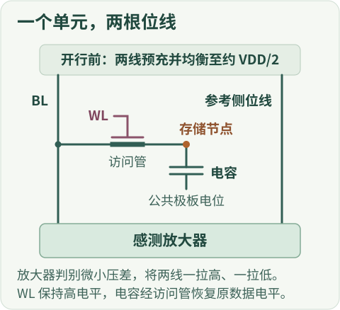
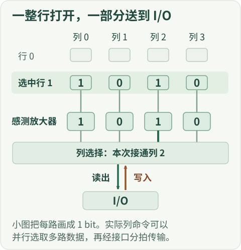

# 只读几个字节，DRAM 为什么先打开一整行？

程序要读数组中的一个 4 B 整数 `A[0]`。假设它所在的 64 B 缓存行没有命中，请求一路到了主存。假设目标行尚未打开，阵列已准备好开行。为了返回这 64 B，我们这个 DDR4 例子中的八颗芯片合计先打开了 **8 KiB** 的数据。其余数据去了哪里？它们留在芯片里。要看清原因，先跟着其中一个 bit，从保存它的小电容走到芯片的数据引脚。[存储层级概览里的数组读取](../../01-memory-hierarchy/README.md#3-逐步看一次-cache-miss)

## 一个小电容，怎样让芯片知道它存的是 1？ {#charge-sharing}

常见 DRAM 的一个存储单元（cell）里有一只访问晶体管和一只电容，因此叫 **1T1C**。先约定高电压表示 1，低电压表示 0。平时晶体管关着，电容上的存储节点与外面的**位线**（BL）隔开。晶体管的栅极接到另一根线，叫**字线**（WL）。拉高字线，电容就能通过晶体管与位线交换电荷。[MOS 管怎样控制沟道](../../../semiconductor-foundations/bands-to-channel/README.md#隔着绝缘层加电压)

读之前，预充电路先把位线和感放用来比较的另一根位线拉到相同的参考电压，通常在供电电压的一半附近。准备就绪后，预充电路释放位线。现在只打开目标字线。若单元原本电压高，一部分电荷从单元流到位线，位线电压略微上升；若原本低，电荷从位线流向单元，位线电压略微下降。另一根位线暂时保持参考电平。

偏移能有多大？假设单元电容为 30 fF，位线的等效电容为 300 fF，预充到 0.5 V。把两者看作理想电容，忽略泄漏和额外寄生。接通后两边趋于同一电压，总电荷守恒，因此可按电容大小求加权平均。[电荷与电压的关系 Q = CV](../../../semiconductor-foundations/cmos-logic-gates/README.md#edge)

| 单元起初 | 共享后的位线与单元电压 | 位线相对参考的变化 |
|---|---|---|
| 1 V，存 1 | (30 × 1 + 300 × 0.5) ÷ 330 ≈ 0.545 V | +45 mV |
| 0 V，存 0 | (30 × 0 + 300 × 0.5) ÷ 330 ≈ 0.455 V | −45 mV |

注意看表中电压的变化。对位线来说，几十毫伏是刚出现的信号；对单元来说，原来的 1 V 或 0 V 已被拉到了 0.5 V 附近。**这就是破坏性读出的“破坏”**。它发生在打开字线、共享电荷时。下面还要把单元拉回原来的高或低。表中数字是教学假设。

## 谁把被扰动的 bit 恢复回去？ {#sense-restore}

位线对的末端接有**读出放大器**，常简称“感放”（sense amplifier）。位线有了可辨的差别后，感放启动。它由电源供能，通过正反馈把电压稍高的一侧往高电平拉，把稍低的一侧往低电平拉。差异由此进一步加大，最后锁存成稳定的 1 或 0。

**此时字线仍开着。** 沿图中的连接往回看：感放驱动位线，位线经过导通的访问管给单元电容充电或放电，原值由此恢复。若先把字线关掉，电容就收不到这次恢复。感放的判决一旦可靠，满足器件时序后即可开始列访问，电容的恢复还可以继续。第一批数据何时出现在引脚上、最早何时允许把行关掉，要分别查时序。[DRAM 激活、恢复与列访问的时序图，图 3](https://users.ece.cmu.edu/~omutlu/pub/understanding-latency-variation-in-DRAM-chips_sigmetrics16.pdf#page=4)

## 为什么同行一起打开，却只输出其中几列？ {#column-select}

把刚才的一组连接向右排开。**一根字线接着同一行许多访问管的栅极；各列有各自的位线。** 控制器发出激活命令（ACT）后，芯片按行地址选中字线。同行的访问管一起导通，每个单元把自己的位线推高或拉低，再由相应的感放判决和恢复。列之间保持各自的值。这里画的是阵列的一小部分；一颗芯片可以把一行分布在多个局部阵列中。

图中编号为 1 的行保存着 `1、0、1、0`。打开它，四个感放便各自锁存一个值。这组感放保存着当前打开行的数据，起到了**行缓冲（row buffer）**的作用。 一组感放可以轮流服务接在相同位线上的许多行，芯片也可以让许多列共用较窄的输出通路。这节省了每 bit 平摊的外围电路，也决定了一次访问的顺序：先选行，让感放取得数据；再由读命令（RD）给出列位置，把所需的一部分接到内部数据通路。图中选通编号为 2 的列，读出的是 1。

例如，一个简化阵列的一行有 16 个内部列位置，通路一次能接出 4 个。第一次可以选出前 4 个，随后还可以从同一打开行选出另一组；其余列一直留在感放中。这个 16 选 4 的例子只说明选择关系。实际器件的行宽、预取和引脚位宽由其组织方式决定。

## 从阵列走到程序，8 KiB 怎样变成了 64 B 和 4 B？ {#access-granularity}

回到开头。假设这组内存没有额外 ECC 芯片，八颗 **x8** 芯片组成一个 **rank**，也就是一起接受选择、共同提供数据位宽的一组芯片。x8 表示每颗在一次数据传输中贡献 8 bit。再约定每颗芯片的一个 bank 中每行有 1,024 个 x8 列位置，使用 BL8（一次突发含 8 次数据传输）。同样的 x8 芯片行宽可以在器件手册中查到。下面把 rank 组合、突发长度和程序取数大小分别算一次。[DDR4 器件手册，表 2](https://www.alliancememory.com/wp-content/uploads/AllianceMemory_AS4C512M16D4B_AS4C1G8D4B_8Gb_DDR4_Datasheet_Rev1.0_Sep2024.pdf#page=2) · [channel、rank、chip 与 bank](./channel-rank-chip-hierarchy.md)

| 观察位置 | 发生的事 | 这次涉及的数据 |
|---|---|---|
| 八颗芯片的阵列内部 | 激活时，每颗芯片的目标 bank 打开一行，每行 1,024 × 8 bit = 1 KiB | 8 颗合计 **8 KiB**，保留在各芯片的行缓冲中 |
| rank 的数据引脚 | 每次传输，八颗各送 1 B，合计 8 B；一次 BL8 连续传输 8 次 | 8 B × 8 = **64 B**，本例用来填充一条缓存行 |
| 发起读取的处理器 | 假设数组按 64 B 对齐，cache 完成填充后把第一个整数交给这次读取 | 程序取得 **4 B**；随后读相邻元素还可以复用该缓存行 |

同一批数据有两次不同的选择。DRAM 的列通路先选出要传的部分；cache 再从取回的缓存行里选出程序要的字节。在这个配置里，只有 64 B 穿过了外部内存数据总线。8 KiB 是这组芯片的开行粒度，4 B 是这条程序读取的粒度。

## 写一个新值时，同一行的其他数据怎么办？ {#write}

沿第二张图把数据方向反过来。行 1 仍然打开，这次向列 2 写入 0，把原来的 1 改掉。写命令（WR）提供列位置，新数据从芯片引脚进入写通路。写驱动通过选中的列连接改变相应位线对的状态，使目标感放锁存新值。字线仍然打开，目标电容经访问管放电，回到代表 0 的低电平。控制器还要留足写恢复时间，才能关行。[RowClone 第 3.2 节的读写与预充过程](https://research.ece.cmu.edu/safari/tr/CMU-CS-13-108.pdf#page=9)

同一行里，**没有接入本次写通路的列**仍由各自的感放维持先前的值，因此那些电容得到的是各自的原值。图中的整行由 `1、0、1、0` 变成了 `1、0、0、0`。至于同一笔写突发覆盖的其他位，要保留它们，就要传入原值，或使用该器件和模式支持的写掩码，掩码有其规定的粒度。这里追踪一个 bit 的变化；一次程序写入从 cache 传到 DRAM 的时间和大小，还取决于写回等策略。[cache 填充与写回](../../01-memory-hierarchy/02-access-paths/cache-dram-coordination.md)

## 下一个请求来了，还要再开行吗？ {#row-state}

**Bank** 是可以维持自身行状态的一组存储资源。用常见 DDR 的显式命令为例，下面三笔读取都以同一个 bank 为目标，先看请求到达时它处于什么状态。

| bank 先前的状态 | 这次要做什么 | 原因 |
|---|---|---|
| 目标行已打开（行命中） | 满足时序后发 RD | 所需数据已经在感放中，直接选列 |
| 当前没有打开行，已预充就绪 | ACT → RD | 先让目标行的数据进入感放 |
| 打开着另一行（行冲突） | 满足条件后 PRE → ACT → RD | 先关掉旧行，复用同一组资源打开新行 |

关行时，芯片先让字线关闭，把已恢复或写好的电容与位线隔开，再把位线对均衡、预充到下一次感测所需的参考电平。这解释了为什么**预充位线不会把存储电容一起抹到 0.5 V**。控制器可以按策略保留打开行，也可以请求自动预充；后者把关行动作安排在器件内部，外部不一定单独发送 PRE。接口也可以向上层隐藏这些命令。[DRAM 命令](../protocols/commands-act-rd-wr-pre.md) · [行保留与预充策略](../../04-dram-controller/command-scheduling-fr-fcfs.md#page-policy)

行命中和 cache 命中都能利用已有数据，但查找的位置不同。cache 用地址和 tag 判断有无副本；在这里，控制器关心的是目标 bank 当前打开哪一行。行命中省下了重新开行的工作，端到端是否更快还要看控制器队列、共享数据总线（DQ）、读写方向切换和刷新占用。[SRAM bank 与 DRAM 行状态](../../01-memory-hierarchy/02-access-paths/sram-vs-dram-access-pattern.md)

### 已经恢复过的行，为什么还要刷新？ {#refresh}

关行以后，电容又得独自保存数据。电荷会随时间泄漏，程序也可能很久都不访问某一行，所以器件还需要周期刷新，及时感测并恢复这些冷行。保持条件会随温度、工艺、单元差异和工作模式变化。1T1C 的小单元有利于提高密度；增大单元电容有助于感测裕量，也可在其他条件相同的情况下延长保持时间，但会受到面积、制造工艺与寄生的约束。完整芯片还要为位线、感放、外围和冗余留面积。[刷新机制与代价](./refresh-the-fundamental-cost.md) · [对照 6T SRAM 怎样保持一个 bit](../../02-sram/foundations/6t-cell-bistable-storage.md)

**检验一下。** 假设第一次读取已经完成，cache line 仍然有效，但 DRAM 控制器已经把那一行关了。程序这时读 `A[1]`，还要重新开行吗？不需要。它与 `A[0]` 在同一缓存行，cache 可以直接响应。反过来，若数据要从主存取，即使 DRAM 行仍然开着，也要选列并通过接口传回来。两份数据住在不同位置，各自有自己的有效条件。

### 要模拟这次读取，哪些状态需要留下？ {#model}

要区别上表三种请求，命令级模型需要为每个受建模的 bank 记录打开行、关闭或预充进度、各类命令最早可发的时刻，并计入感测、恢复与刷新等时序约束。再加上排队时间与共享数据总线的占用，才能解释行命中率相近的两段程序为什么耗时不同。[DRAM 控制器与请求调度](../../04-dram-controller/README.md)

模型可以把电荷共享折算为器件时序。实现时要区分外部命令的采样、内部列操作、引脚上首批数据有效、允许关行这几个时刻；例如 DDR4 启用附加延迟（AL）时，外部列命令可以先于内部列操作。若要研究数据保持错误，还需在明确的工作条件下取得保持时间分布。[时序参数与参考边沿](../protocols/commands-act-rd-wr-pre.md#开行列访问与首数据)

**接下来读**　把刚才的三种行状态放进同一条时间线，看看每次可以何时发命令、何时收到数据。[同一个 DRAM bank 的三笔读取](../protocols/commands-act-rd-wr-pre.md#three-reads)。如果两笔请求落在不同的 bank，哪些操作又可以同时进行？[Bank 与并行性](./bank-organization-parallelism.md)
