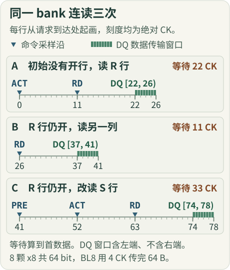

# 同一个 DRAM bank 连读三次，为什么等待时间不同？

内存控制器先后收到三笔读请求，每笔都要 64 B，都落在同一个 DRAM bank。把探头放在内存芯片的数据引脚上，从每笔请求到达控制器开始计时：在下面的例子里，第一笔等 22 个时钟周期才见到第一份数据，第二笔只等 11 个，第三笔却等了 33 个。三次在线上传送 64 B 的时间完全一样。多出来的时间花在哪里？

## 先看三笔读落在哪里 {#three-reads}

选同一 rank 的同一 bank。第一次读 **A**，目标是行 R 的一段，bank 起初已经预充好，没有打开的行。第二次读 **B**，它要行 R 里的另一段。第三次读 **C**，它要同一 bank 中行 S 的一段。控制器在读完 A、B 后保留行 R 打开，直到需要换行。三笔都由主存供数。若沿用系列首页的示例映射，A、B、C 的物理地址可分别取 `0x1000`、`0x1800`、`0x41000`。前两笔读第 0 行的不同位置，第三笔才换到第 1 行。下面只观察控制器、芯片和它们之间的接口。[从程序的 4 B 读取走到内存控制器](../../README.md#first-load)

图上有两种时刻。**命令**标在哪个时钟沿被芯片采样；**数据**标在哪段时间占用数据引脚（DQ）。两者可以相隔很多拍。全文用 CK 数时钟周期，CK 0 是共同起点，1 CK 取 1.25 ns。控制器在请求到达的那个沿就能选择命令。主图中没有其他请求争用接口，也没有刷新、低功耗退出或控制器流水线额外占用这些周期。

下面采用 DDR4-1600 的一组时序。以手册给出的 13.75 ns 为例，除以 1.25 ns 就是 11 CK。我们采用显式关行、BL8、正常读模式，附加延迟 AL 为 0，关闭命令/地址奇偶校验、CS-to-CA 延迟和读数据总线反转。具体模式为什么重要，留到文末再看。[SK hynix DDR4 时序表，第 4 页](https://product.skhynix.com/files/pcms/Products/TechnicalResources/DataSheet/TR-20201119010111015.pdf#page=4) · [Alliance DDR4 读后预充时序，图 152](https://www.alliancememory.com/wp-content/uploads/AllianceMemory_AS4C512M16D4B_AS4C1G8D4B_8Gb_DDR4_Datasheet_Rev1.0_Sep2024.pdf#page=200)

## 第一笔，为什么 CK 0 不能直接读列？ {#first-read}

行 R 的数据还在一排微小的电容里。控制器先在 **CK 0** 发激活命令 **ACT**，告诉芯片要打开哪一行。字线选通这一排单元，电容和位线共享电荷，感放把位线上的微小差别放大并锁存下来。此后选列电路才能从感放取出指定的一部分数据。这组感放保存着打开行里的值，也就是行缓冲。[跟着一个 bit 看感测、恢复和选列](../foundations/1t1c-cell-destructive-read.md#sense-restore)

从 ACT 到允许开始内部列访问，要满足最短间隔 **tRCD**。本例取 11 CK，又因为 AL 为 0，最早能在 **CK 11** 采样列读命令 **RD**。此时行地址已经由 ACT 选定，这次 RD 指定要读的列位置。从 RD 被采样到第一份数据出现在引脚上，还要经过列读路径和输出通路。本例的名义读延迟是 11 CK，所以**第一份数据在 CK 22**。

这一份有多大？八颗 x8 芯片一起响应，一次每颗送 1 B，合计 8 B。BL8 表示连续八次传输，合计 64 B。DDR 每 CK 传两次，因此这笔突发占 **4 CK**。以理想的半 CK 网格记，八次传输依次在 22、22.5、…、25.5，数据窗口写成 **[22, 26)**。26 是窗口的右端。**等第一份数据花了 22 CK，在线上传完整条数据又占了 4 CK。** 图里的刻度表示名义传输时刻，电气上每个引脚的有效窗口还要看器件 AC 时序。

## 第二笔，同一行里换一段数据，还要再开行吗？ {#row-hit}

**CK 26**，B 到了。A 的突发刚结束，但控制器没有发关行命令。行 R 仍连着感放，B 要的那一段也已在行缓冲里。由于前后的列命令间隔和数据线都允许，控制器在 **CK 26** 就能发另一个 RD，只换列位置。

这次首数据在 **CK 37**，数据窗口为 **[37, 41)**。B 从到达到首数据等了 **11 CK**。与 A 相比，省下的正是开行后等待第一次列访问的那 11 CK。**行命中**说的是数据已经在目标 bank 的行缓冲里。这 64 B 依然要从 DRAM 芯片传出来。

## 第三笔，同一组感放怎样换到另一行？ {#row-conflict}

**CK 41**，C 要读行 S，但感放里仍是行 R。同一 bank 的这套行缓冲一次只能服务一个打开的行。控制器先发 **PRE**，让芯片收好旧行、关闭字线，把位线对重新均衡到参考电平。否则位线上还留着上一行放大后的电压，下一行很小的电荷变化就失去了合适的感测起点。[关行时，为什么不会把单元里的数据抹掉？](../foundations/1t1c-cell-destructive-read.md#row-state)

能在 41 发 PRE 吗？本例要求从上次 ACT 到 PRE 至少 **28 CK**（tRAS），从最近一次 RD 到 PRE 至少 **6 CK**（tRTP）。两项约束给出的最早关行时刻分别是 0 + 28 = 28 和 26 + 6 = 32。到 41 时两者都已过去。

PRE 后要等 **11 CK**（tRP）才能在 **CK 52** 发 ACT 打开 S。同一 bank 两次 ACT 还须至少相隔 **39 CK**（tRC），从 CK 0 到 52 也满足。再经 tRCD，**CK 63** 发 RD，**CK 74** 出现首数据，数据窗口为 **[74, 78)**。C 等了 **33 CK**，分别用在关闭旧行并预充位线的 11 CK、激活新行后到列访问的 11 CK，以及发 RD 到首数据的 11 CK。

回看图中的三条路径：A 从已预充的 bank 出发，B 直接使用打开的行，C 到达时还得先关掉另一行。**22、11、33 CK 都只从控制器接到请求算到芯片引脚首数据。** 处理器什么时候拿到它需要的字节，还取决于返回路径和缓存填充。

## 只让 C 早一点来，能提前几拍拿到数据？ {#early-pre}

现在仍按 A、B、C 的顺序处理，所有模式和地址都不变。只允许 C 在 B 的数据还没传完时就到达，把它从 CK 41 提到 **CK 30**。能马上关行吗？

- 行 R 从 CK 0 开始激活，tRAS 要求留到 CK 28，C 到时这项条件已满足。
- B 的 RD 在 CK 26 才发出，tRTP 要求到 **CK 32** 才能预充。C 还要等 2 CK。
- 于是 CK 32 发 PRE，CK 43 发 ACT，CK 54 发 RD，CK 65 才见到 C 的首数据。B 原定在 **[37, 41)** 传出的数据仍按时传出。

这里容易看错的是 **PRE 在 CK 32，B 的首数据却在 CK 37**。前者约束 bank 何时可以开始预充；后者标出先前那笔列读的数据何时走到引脚。只要手册规定的读到预充等条件都满足，列读的数据可以沿读出通路继续前进。厂商给出的时序图里同样画出了 PRE 早于首数据的情形。[DDR4 显式 RD、PRE 与 DQ 的相对位置，图 152](https://www.alliancememory.com/wp-content/uploads/AllianceMemory_AS4C512M16D4B_AS4C1G8D4B_8Gb_DDR4_Datasheet_Rev1.0_Sep2024.pdf#page=200)

C 的请求提前了 11 CK，首数据从 74 提前到 65，只早了 9 CK。若从 C 自己到达时开始计时，它反而等了 **35 CK**。两次的差额正是那 2 CK 的读后等待。

## 行已经命中，请求还可能在哪里等？ {#queue-and-bus}

把目光放回 B。只改变一个条件：另一个 bank group 中的 bank 在同一 rank 上于 CK 24 发了 RD，已经预订同一组数据引脚的 **[35, 39)**。如果 B 仍在 26 发 RD，它的数据窗口 **[37, 41)** 就会和前一笔重叠。在相同读延迟、跨 bank group 的连续读列命令最短间隔为 4 CK、其他条件均满足时，B 最早到 **CK 28** 才能发 RD，让自己的数据使用 **[39, 43)**。行 R 一直开着。本次多等的 2 CK 来自列命令间隔和共享数据线的时段约束。

再区分一种等待。假如 B 的 RD 在某个沿已经合法、将来的数据窗口也空着，但控制器把这一拍的命令位置给了另一个请求，B 仍须在队列里等。查看一段命令记录时，可以逐笔问：是 bank 的状态和时序还不允许，是数据引脚被预订，还是有几条合法命令正在竞争同一个发射机会？[控制器怎样在就绪请求之间调度](../../04-dram-controller/command-scheduling-fr-fcfs.md#ready) · [何时保留打开的行](../../04-dram-controller/command-scheduling-fr-fcfs.md#page-policy)

## 查参数时，哪些前提会改变上面的算法？ {#mode-and-writes}

**列命令的外部采样沿与内部执行沿。** 本篇的 ACT、RD、WR（列写）和 PRE 属于显式 DDR 接口。某些器件会在接口内部管理开关行。即使在 DDR4 上，启用附加延迟 AL 后，外部 RD/WR 也可以提前采样。以关闭 CA parity 和 CS-to-CA latency 的模式为例，若 ACT 在周期 `a` 采样、RD 在周期 `r` 采样，单看 tRCD 应检查 `r + AL ≥ a + nRCD`。这里的 `nRCD` 是用 CK 表示的最小间隔；还须满足其余适用规则。

同一模式下，从外部 RD 到首数据的名义读延迟 **RL = AL + CL**，主例 AL = 0 才得到 11 CK。Alliance 器件手册在特定命令/地址奇偶校验模式下给出 **RL = AL + CL + PL**、**WL = AL + CWL + PL**。若关闭 CS-to-CA 延迟，取 AL = 0、CL = 11、奇偶校验延迟 PL = 4，名义 RL 就是 15 CK。读数据总线反转（DBI）、写 CRC、突发模式及合法 CL/CWL 值也要按器件核对。[Alliance DDR4 命令/地址奇偶校验模式](https://www.alliancememory.com/wp-content/uploads/AllianceMemory_4Gb_DDR4_AS4C512M8D4A-75BCN_75BIN_Aug2022_Ver1.0.pdf) · [读 DBI 模式举例](https://www.alliancememory.com/wp-content/uploads/AllianceMemory_AS4C512M16D4B_AS4C1G8D4B_8Gb_DDR4_Datasheet_Rev1.0_Sep2024.pdf#page=203)

### 如果打开的行还接收过写数据 {#写恢复与参数适用条件}

WR 告诉器件要写哪一列，写数据要到后面的突发窗口才送到。单元写入后还需要恢复时间 tWR。因此算“何时允许关行”，起点要选手册规定的**写数据参考沿**。如果参数既给出最小纳秒数又给出最少时钟数，常见换算是 `n = max(最少时钟数, 向上取整(最小时间 / tCK))`，具体取整规则和模式依器件而定。

在 DDR4、正常时钟、BL8、写 CRC 关闭、CA parity 和 CS-to-CA 延迟均关闭的条件下，记 `WL = AL + CWL`。从这次 ACT 开始，**对同一打开行**计算下面三项时间下界。没有对应读或写时，略过那一项。

| 必须满足的条件 | 显式 PRE 不得早于（均按 CK 计） |
|---|---|
| 行已保持足够久 | ACT 的采样时刻 + nRAS |
| 已执行的每一笔读都允许预充 | 各 RD 采样时刻 + AL + nRTP 中的最大值 |
| 已送入的每一笔写都完成恢复 | 各 WR 采样时刻 + WL + BL/2 + nWR 中的最大值 |

取所有适用下界的**最大值**。它们可以同时向前推进。还须检查命令总线、刷新、bank 状态等其余限制。控制器也可以在列命令里请求**自动预充**，这时芯片按相应模式自行安排内部预充，它发生的时刻需要另算。

沿用一个独立的写例子，把 WR 的采样沿重新记为 CK 0。取 AL = 0、CWL = 9、BL = 8、nWR = 12。写数据的首个传输在 9，最后一个在 12.5，数据窗口是 **[9, 13)**。写恢复从参考沿 13 开始数，给出 13 + 12 = **25**。假如在这个独立例子中，ACT 对 PRE 给出的最早时刻是 **28**，PRE 就还得等到 28，其他约束也要同时满足。[DDR4 写后预充，图 189 标出了写恢复的参考沿](https://www.alliancememory.com/wp-content/uploads/AllianceMemory_AS4C512M16D4B_AS4C1G8D4B_8Gb_DDR4_Datasheet_Rev1.0_Sep2024.pdf#page=223) · [时序参数速查](../../reading-and-reference/02-reference/timing-parameter-cheatsheet.md)

### 在模拟器里留下哪些状态？ {#建模启示}

逐 bank 保存当前打开的行、激活沿和允许下一条命令的最早时刻；逐通道记录命令发射机会、已预订的 DQ 窗口和读写方向，再检查跨 bank 约束、刷新和低功耗状态。若模型要回答“为什么这笔晚了”，还要留下到达、候选命令就绪、实际发出、首数据和突发结束几个时刻。从同一条轨迹上才能区分排队、阵列准备和传输。[DRAM 控制器建模](../../04-dram-controller/mc-modeling-for-simulation.md)

**接下来读**　把 BL8 的八次传输沿着数据线放大看，为什么只占 4 CK？[DDR 双沿传输](./why-double-data-rate.md)。如果多笔请求同时在队列里，为什么后到的可能先读？[跟着控制器作一次选择](../../04-dram-controller/command-scheduling-fr-fcfs.md#queue-choice)。
