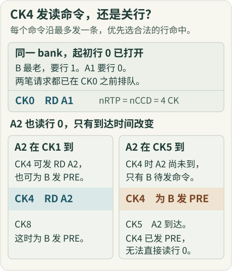

# DRAM 控制器为什么先服务后来排队的读取？

请求 B 比 A1 先到内存控制器。两笔都是读，都要同一个 bank。轮到控制器发命令时，B 所需的第一步可以做，A1 所需的第一步也可以做。控制器却先读了 A1。四拍以后，它甚至可能让更晚到的 A2 再越过 B 一次。为什么值得让最老的请求等？A2 在第 4 拍到达，和在第 5 拍到达，又有什么不同？

## 三个地址，为什么有人只要读列，有人却要先关行？ {#address-map}

沿用[地址映射篇](./address-mapping-channel-rank-bank-row-col.md#用同一地址流比较两种映射)的小模型。一个 rank 里有 4 个 bank，每个 bank 独立保留一条打开的行。把一次能连续读出的数据块叫作一段，下面用 `line 1`、`line 2`、`line 32` 表示主存中编号为 1、2、32 的段。三个编号已经除去了段内字节偏移。

先用**映射 X**：相邻 8 段填入同一 bank 的同一行，再轮到下一个 bank。因此 line 0–7 占 bank 0 的行 0，8–15 占 bank 1 的行 0，一直排到 line 32 才回到 bank 0 的行 1。假设从各 bank 关闭的状态起，控制器已经按顺序读完 line 0–7，并保留打开的行。第一次要开行，后七次都能复用它。现在 bank 0 的行缓冲里仍是行 0。

| 请求 | 目标 | 此刻需要的下一条命令 |
|---|---|---|
| B，最早入队 | line 32，bank 0、行 1 | 先用 PRE 关掉行 0，之后才有机会用 ACT 打开行 1，再用 RD 读列。 |
| A1，随后入队 | line 1，bank 0、行 0 | 行已打开，可以申请 RD 读列。 |
| A2，还在路上 | line 2，bank 0、行 0 | 如果它到达时行 0 仍开着，也可以申请 RD。 |

关键在于**控制器每次选择的是一条命令**。为 B 发 PRE，只意味着开始替 B 腾出这个 bank，还没有读出 B 的数据。先给 A1 发 RD，则能立刻启动对已打开行的列访问。两种选择都会改变下一拍还能做什么。[回顾 PRE、ACT、RD 各自在芯片里做什么](../03-dram/protocols/commands-act-rd-wr-pre.md#row-conflict)

## 在第 0 拍，是谁决定 A1 可以先走？ {#ready}

把这一批请求第一次参与仲裁的时钟沿记作 **CK 0**。B、A1 已按这个先后顺序入队。此前的操作留给 bank 足够时间，CK 0 发 B 所需的 PRE 和发 A1 的 RD 都符合时序。三笔读相互独立，也允许调整服务顺序。我们采用如下规则，每拍至多发一条命令。

1. 看每笔**已经到达**且允许参与仲裁的请求，依据 bank **现在**的状态，列出它需要的下一条命令。
2. 删去这一拍还不能发的命令。除了阵列时序，列命令还需要将来能用的数据总线时段。行命中也可能暂时不能发 RD。
3. 在剩下的命令里，优先选对已打开行可立即发出的 RD 或 WR（列写）。同等优先级时，先服务入队较早的请求。若同拍入队，按固定编号打破平局。若一条都发不出，等状态或队列变化再选。

这是一种可以逐拍推演的 **FR-FCFS**（first-ready, first-come, first-served）教学规则。在 CK 0，B 的 PRE 和 A1 的 RD 都通过了第二步。第三步优先利用已经打开的行，所以发 **RD A1**。假如规则改成“在所有合法命令中只选最老的请求”，这一拍就会选 B 的 PRE。两种规则都遵守器件时序。

真实控制器要把优先级写得更具体。例如，Rixner 等人的论文分别比较了最老可发操作优先、列命令优先等策略。gem5 的一个实现还会检查列命令发出后能否接上数据总线，以及其他 bank 的准备工作能否藏进已有等待时间里。[Memory Access Scheduling，第 5 节](https://groups.csail.mit.edu/cag/PSRG/papers/rixner_isca27.pdf) · [gem5 的 chooseNextFRFCFS 实现](https://gem5.googlesource.com/public/gem5/+/fbaa164b6a7275760066b62fb863501c67dd2ffe/src/mem/dram_interface.cc#64)

## CK 4，B 的关行命令已经合法，为什么还要等？ {#queue-choice}

先让 A2 在 **CK 1** 到达。这里另设一组方便手算的教学间隔：AL 为 0，同一 bank 从 RD 到允许 PRE 至少 4 CK（nRTP），两条连续 RD 至少相隔 4 CK（nCCD）。在下面列出的发射时刻，其余命令、数据总线和时序条件均满足。没有异行请求时，控制器会保留当前行。发命令时只考虑已经入队的请求，有合法候选就按上述规则选一条。这个模型只数命令沿，上一篇 DDR4-1600 算例的参数另有规定。

| 时钟沿 | 此时可以做什么？ | 实际发出 |
|---|---|---|
| CK 0 | 为 B 关行，或读 A1。 | **RD A1**。这次读把下次同 bank 的 PRE 和下次 RD 都推到最早 CK 4。 |
| CK 1–3 | A2 已经到达，行也匹配。但距刚才的 RD 还不到 4 CK。B 的 PRE 同样在等。 | 无命令可发。 |
| CK 4 | **RD A2 与为 B 发 PRE 同时合法。** | **RD A2**。它重用了行 0，同时把最早能 PRE 的时刻推到 CK 8。 |
| CK 8 | 两个行 0 的读都已经发出。队列中没有新的同行请求。 | **为 B 发 PRE**。此后还要等预充完成、开行、读列，B 才能得到数据。 |

从 CK 4 到 CK 8，B 又多等了 4 CK 才开始关行。这里能从命令轨迹直接量出的，是**B 何时开始换行**。要算到 DRAM 引脚上出现首数据，还得接着推演 ACT、RD 和列读延迟。要算到请求方收到数据，还要算返回路径。

## 只把 A2 的到达时间从 CK 1 改到 CK 5 {#arrival-change}

固定地址、行状态、时序和仲裁规则。CK 0 照常读 A1。现在走到 **CK 4**：A2 还没入队，控制器看得见的候选只剩 B 的 PRE。于是它当场为 B 关行。**CK 5**，A2 终于到达。它的地址还是 line 2，可 CK 4 的 PRE 已经发出，原来的行 0 已经不能直接读了。若要再读行 0，必须等 bank 可以激活、重新开行并满足列访问时序。

可以再试一个恰好落在边界上的时刻：如果 A2 **正好在 CK 4 到达**呢？在本例里约定先接收当拍到达的请求，再仲裁，所以它来得及参加，结果与 CK 1 到达一样。若一个控制器规定本拍接收、下拍才参加仲裁，答案就会改变。

### 保持原来的到达时间，只换地址映射呢？

把 A2 放回 CK 1，重新从各 bank 关闭开始读 line 0–7。改用**映射 Y**：相邻段轮流分给 4 个 bank。前四段在四个 bank 各开一次行，后四段各命中一次，共 **4 次行命中**。映射 X 的同一次预热有 **7 次**。预热结束时仍约定此前的时序均已满足。

现在 A1（line 1）读 bank 1 的行 0，A2（line 2）读 bank 2 的行 0，而 B（line 32）需要把 **bank 0** 换到行 1。CK 0 仍可先发 A1 的 RD。可是它的读后预充间隔只约束 **bank 1**。在本模型同一 rank 的两次 RD 仍须间隔 4 CK、其他资源可用的条件下，CK 1 到达的 A2 还不能发 RD，这一拍却已可以**为 B 在 bank 0 发 PRE**。同一组请求换一种放置方式，便出现了边等另一个列读、边准备 B 所在 bank 的机会。只比较命中次数，会漏掉这个差别。[映射 X、Y 的地址位与 bank 序列](./address-mapping-channel-rank-bank-row-col.md#用同一地址流比较两种映射)

## 队列暂时空了，这一行是留着，还是提前关掉？ {#page-policy}

上面的控制器有 B 在等待，所以知道关行能帮到谁。现在另做一次实验：bank 0 仍打开行 0，队列暂时为空，下一笔还没有到。这里的 **page policy** 说的是控制器怎样对待这条打开的 DRAM 行。操作系统做地址翻译时用的虚拟内存页是另一个概念。

**保留行（open-page）**会把当前的行缓冲留给可能到来的同行请求。**尽早关行（close-page）**则会在条件允许时安排预充，把空闲时间用来准备下一次激活。用映射 X 算一次：假设 bank 最早在 CK 12 可以 PRE，PRE 到下次 ACT 要 4 CK，ACT 到 RD 要 3 CK，AL 为 0，其余条件均满足。这一组数只用于比较关行策略，时间从这次独立实验起算。

两种策略面对的**下一笔请求都在 CK 20 到达**。如果提前关行，控制器只知道没有待处理请求，所以 CK 12 发 PRE，CK 16 bank 准备好接收 ACT。它还不知道下次要开哪行，要到 CK 20 才能决定。

| CK 20 到达的下一笔读 | 提前关行 | 保留行 0 |
|---|---|---|
| line 1，还要行 0 | CK 20 重新 ACT，最早 **CK 23 发 RD**。 | 行还开着，**CK 20 可发 RD**。 |
| line 32，要行 1 | CK 20 ACT 行 1，最早 **CK 23 发 RD**。 | CK 20 才 PRE，CK 24 ACT，最早 **CK 27 发 RD**。 |

所以，同一个“提前关行”决定，让同行读的 RD 晚了 **3 CK**，却能让异行读的 RD 早 **4 CK**。这两个数回答的是列命令何时发出。再把异行请求提前到 CK 14：提前关行的 bank 到 CK 16 可 ACT、CK 19 可 RD。保留行的 bank 到 14 才 PRE、18 可 ACT、21 可 RD。4 CK 的预充只藏住了 2 CK。若异行请求在 CK 12 前就已到达，两种策略都在第一个合法时刻 12 发 PRE，也就没有这项提前量。

**自适应策略**可以看队列里是否还留有同行请求、最近是否连续访问同一行、已经空闲了多久，再决定是否保留。它能利用已到达的信息，却看不到未来。比较两种策略时，应重放同一串带到达时间的请求，并保持映射、容量和时序一致，分别记录关行次数、行命中数、RD 时间和请求等待。

**自动预充（auto-precharge）**是把关行动作交给器件执行的一种方式。支持该功能时，控制器可以发出带自动预充的列读或列写，器件按模式和时序条件在内部开始预充。“希望这次读完就关”属于策略，“随列命令请求自动预充”属于实现这项决定的机制。AMD 的一个内存控制器默认保留打开的行，也允许逐笔请求指定自动预充。[AMD PG150 的 Autoprecharge 说明](https://docs.amd.com/r/en-US/pg150-ultrascale-memory-ip/Autoprecharge?contentId=dxL76eC_fD3vaafa125usw) · [显式 PRE 要满足哪些时间下界](../03-dram/protocols/commands-act-rd-wr-pre.md#ddr4-同-bank-显式-pre-的完整下界)

## 如果同行请求一直来，最老的 B 会怎样？ {#fairness}

把 CK 4 的选择再重复几次。只要每逢 PRE 即将合法时，队列里就有可发的同行 RD，列读优先就可能一次次推迟 B。连续利用行缓冲能省掉一些关行、开行的工作。对正在等另一行的 B，每多发一条同行 RD，却可能意味着又要等一个读后间隔。队列深度、刷新、最大开行时间、写排空和仲裁规则都会影响它最终要等多久。单凭 FR-FCFS 这个名字，推不出等待上界。

控制器可以让等待过久的请求逐步提升优先级，也可以限制连续优先服务同行请求的次数，或在多个请求源之间仲裁。回到 CK 4，若 B 的优先级因此更高，控制器便能在合法时刻选择 PRE。已经发出的命令、已经预订的数据窗口和之后必须满足的器件间隔仍要兑现。[多请求源的 QoS、公平性与隔离](./qos-multi-master-arbitration.md)

### 在模拟器里，怎样看出 B 在等什么？ {#model}

给每笔请求记下到达时刻、下一条候选命令、挡住它的条件、实际发射时刻以及完成时刻。CK 1–3 的 B 是“RD 后还不允许预充”，CK 4 的 B 是“PRE 已合法，这一拍选了 A2”。两笔等待在计数器里都可能只表现为队列非空，但解决它们需要不同的办法。

每个发射沿按同一份 bank 状态、命令总线和数据窗口检查并更新资源。若同拍还有别的选择共享这些资源，要用更新后的状态重新校验。发出 RD 的请求转入等待数据，不能在下一拍被重复选成同一笔 RD。还应分别记录预充开始、预充结束和下一 ACT 可发的时刻，才能测出提前关行到底藏住了几拍。[同 bank 的 PRE 时序记录](./mc-modeling-for-simulation.md#同-bank-pre-记分板)

**接下来读**　把一部分读请求换成写，数据线还要改变方向。为什么控制器常常让写请求先攒一批，再集中服务？[写缓冲与写排空](./write-buffer-write-drain.md)
