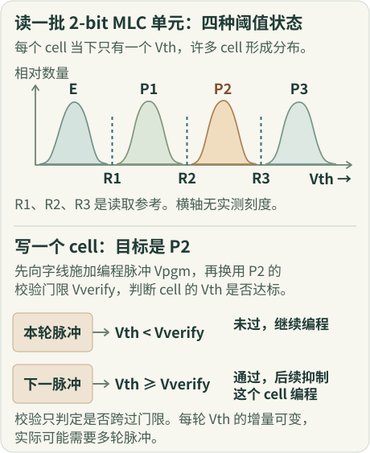
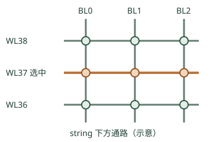

# SSD 只更新 A 页，为什么同一块里的 B 页还能读到？

## 写入之前，A 和 B 在哪里？ {#update}

假设 SSD 的一块 NAND 闪存里存着两页数据。第一页是 A，第二页是 B。主机发来新版 A，要求以后读 A 时返回新内容。NAND 能按页编程，却通常要按整块擦除。如果现在擦掉 A 所在的块，B 也会一起消失。可是，主机既没有把 B 一并发来，也不知道 B 存在哪儿。SSD 怎么完成这条写请求？

先区分两种地址。主机说的 **A、B 是逻辑地址**，名字可以一直沿用。NAND 里真正存放数据的位置是**物理地址**，例如“块 X 的第 0 页”。SSD 控制器保存两者之间的对应关系。于是它有一个选择：在另一处写出新版 A，让 A 指向新位置。这次更新可以让 B 安稳地留在原处。等到控制器真的要擦除块 X，事情才轮到 B。

这个办法用到了 NAND 的两个物理特性。为什么一页可以写到新位置，却很难在原处随意改写？为什么最后腾空间时，又必须以整块为单位？先从 A 页里的一个存储单元看起。

## 一个晶体管怎样记住数据？ {#threshold}

普通晶体管的栅极控制沟道导电。想象我们慢慢升高栅电压，直到沟道达到约定的导电条件。对应的栅电压叫**阈值电压**，记作 Vth。NAND 的存储单元（cell）在栅极与沟道之间多了一处可以长期保存电荷的结构。它可以是被绝缘层包住的浮栅，也可以是电荷俘获层。撤掉外加电源后，留在这里的电荷仍会影响沟道。下次再读，就能从沟道的响应推断之前写了什么。

以常见的 n 沟道电荷俘获单元为例。编程时，强电场使一部分电子进入俘获层。增加的负电荷使栅极要施加更高的栅电压，才能达到原来的导电条件，Vth 随之升高。擦除时，器件利用不同的偏置让 Vth 回到较低范围。一类 3D NAND 通过注入空穴来抵消俘获电子的作用；浮栅器件改变存储电荷的路径又有所不同。[KIOXIA 的 3D 电荷俘获单元图及擦除机制，图 1、4](https://www.kioxia.com/en-jp/rd/technology/topics/topics-88.html)

读出时，可以给栅极一个已知的参考电压。在相同的其他条件下，低阈值的单元已经比较容易导通，高阈值的单元还很难导通。感测电路据此回答一个问题：**这个单元的阈值落在参考线的哪一侧？** 只划一条线，就能区分两个状态，对应 1 bit。若能可靠地区分四个区间，就能为每个区间分配一种两位编码，一个单元便能保存 2 bit。

| 常见称呼 | 每个 cell 存的数据 | 需要区分的阈值状态 | 分开全部相邻状态的边界数 |
| --- | ---: | ---: | ---: |
| SLC | 1 bit | 2 | 1 |
| MLC（此处指 2-bit MLC） | 2 bit | 4 | 3 |
| TLC | 3 bit | 8 | 7 |
| QLC | 4 bit | 16 | 15 |

先看图的上半部分。横轴是阈值电压，纵轴是落在相应电压附近的单元相对数量。每个单元在这一刻只有一个 Vth。即使许多单元都要写成 P2，实际落点也有散布，合在一起才有图中的小山。若一个单元在 R2 下还难以导通，到 R3 已能导通，就能把它判作 P2。图中的间隙是理想示意。电荷保持时间、干扰和磨损都会影响实际判决余量。

那么，读一页 2-bit MLC 要比较三次吗？看一个具体编码。假设 E、P1、P2、P3 依次表示 11、01、00、10。只取每个编码的右边一位，沿横轴读到的是 **1、1、0、0**。这位只在 R2 处翻转，所以比较一次 R2 就能取回它。对一组 cell 都这样做，就得到一整页低位数据。换成左边一位，序列是 **1、0、0、1**，这时需要区分的是 R1、R3 两条边界。这解释了为什么同一组 cell 可以保存两页数据，以及为什么表中的边界总数不能直接当作读一页的感测次数。具体编码、读重试和纠错还会影响实际延迟。[Luo 等，MLC 的位页和读取参考，图 1](https://www.pdl.cmu.edu/PDL-FTP/NVM/online-flash-channel-modeling_jsac16.pdf)

## 一根串上有许多单元，怎样只读其中一个？ {#string}

单元的阈值要靠沟道的响应才能读出。但 NAND 把许多 cell 首尾串联成一条 **string（串）**。任意一处截断电流，整条串的读数都会受影响。如果只观察串的一端，怎么知道是目标 cell 阻断了它？

图中的 WL37 是一条**字线（wordline，WL）**。在画出的三条 string 上，它各控制一个 cell 的栅极。图中相交的位置表示栅极能控制沟道，二者之间隔着绝缘层。**位线（bitline，BL）** 接到感测电路，可以观察被选中 string 的响应。图只画了局部，省略了串两端的选择管和阵列的其他分组。

现在读中间那条 string 的 WL37。外围电路先选通这条串，给**同串其余相关字线**施加足够的通过电压 Vpass，使沿途的其他 cell 都尽量导通。只给 **WL37** 施加要比较的读取参考电压。这样，目标 cell 是否导通就会明显改变整条串的电流，感测电路可以在 BL 端通过电流或电压变化作出判决。按需要换一个参考电压，再观察一次，就能得到另一次比较的结果。

同一条 WL 可以同时选择许多串上的 cell。外围电路沿多条 BL 并行判决，让一排锁存器暂时保存结果，这组用于阵列读写的缓冲电路通常称为 **page buffer（页缓冲器）**。多位编码所需的比较完成后，设备可以从缓冲器分段取数据。并行感测的范围取决于串选择、阵列分组和外围电路。反复给未选字线施加通过条件也可能逐渐扰动电荷状态，这就是读取同样需要考虑可靠性的一个原因。

阅读器件资料要留意电压名。本文把目标 WL 的读取参考记作 Vread，未选 WL 的通过电压记作 Vpass。有的资料用 Vread 表示读取期间的**通过电压**。先看电压加在哪根字线上，再去理解符号。[SanDisk 专利的读取偏置示例](https://patents.google.com/patent/US10283208B2/en)

## 写入 P2 时，电路怎么知道可以停了？ {#program-verify}

回到阈值图的下半部分。假设新 A 的编码要求一个已擦除的 cell 最终落入 P2。不同 cell 得到相同脉冲后，阈值上升的幅度会有差别。若用一个很强的脉冲一次写足，有的可能还没到，有的已经越过目标区间。越过以后，普通编程脉冲又很难只把这一个 cell 的 Vth 调低。

一种常见做法叫**增量阶梯脉冲编程（ISPP）**。页缓冲器先存下待写数据，电路据此知道哪些 cell 需要往哪个状态编程。选中 WL 收到一次短编程脉冲 Vpgm，目标 cell 的阈值向上移动一段。随后电路切换到校验条件，用 P2 的校验门限 Vverify 来感测。这里关心的是“已经达到本轮要求了吗”，无需测出一个精确的 Vth。

假设这个 cell 第一次没有通过，后续一轮便可用稍高的编程脉冲再推一小步。若它已经达到 P2 的校验要求，控制电路记录结果，并通过相应的位线和串偏置**抑制这个 cell 后续编程**。同一条 WL 上，写得慢的邻居还能继续接受编程。这样，共用字线的一排 cell 可以在不同轮次停下来。图里画了两轮，实际脉冲数、校验调度和成功判据由器件决定；Vverify 与读取数据用的 R2、R3 也承担不同职责。[SanDisk 的编程脉冲示例，图 12、23–24](https://patents.google.com/patent/US20220415417A1/en)

现在考虑在原位置把旧 A 改成任意新 A。有些 cell 的目标阈值要升，有些却要降。前一类变化可能与编程方向相符，后一类需要擦除来重新取得低阈值起点。器件有时允许受限的分次编程，仍须满足规定的次数和顺序。

为什么擦除会牵连邻居？看一种具体设计：同一块里的许多串共用一片半导体区域。擦除时，器件抬高这片区域及串沟道的电位，同时把这个块的多条字线保持在低电位。于是许多 cell 同时获得了擦除所需的电场。外围电路用这种方式选中、驱动的一组页，构成一个**擦除块（block）**。标准块擦除命令只需指定块。即便控制器知道哪个 cell 需要降低阈值，这条命令也会擦掉同块的其他页。这是常见电路与命令的粒度，专门支持局部擦除的设计需要额外的选通或偏置手段。[SanDisk，整块擦除与局部擦除设计](https://patents.google.com/patent/US9711229B1/en) · [Micron，NAND Flash 101，擦除和页编程示例](https://courses.cs.washington.edu/courses/cse470/26sp/readings/micron-tn2919.pdf#page=13)

## 主机写 4 KiB，到底动了多少数据？ {#granularity}

| 站在哪一层看 | 这一层实际做的事 |
| --- | --- |
| 主机与 SSD | 主机给出起始逻辑块地址（LBA）和长度。一条 4 KiB 写请求可以覆盖一个或多个逻辑块，取决于设备的逻辑块大小。 |
| NAND 阵列 | 读和编程通常按页（page）组织。多位 cell 的一组物理单元可以承载多个逻辑位页，例如低位页和高位页。完整 WL、某个逻辑位页和主机的一次请求，各有自己的范围。 |
| 页缓冲器与内部传输 | 阵列先感测数据，设备再按所需范围从缓冲器取出、纠错并传送。若所需数据已缓存，可能直接命中。即使某种接口允许主机只取 64 B，也不能据此推断阵列只感测了 64 B。在普通块接口 SSD 上，应用要的 64 B 可能只是一次逻辑块读取的一小部分。 |
| 擦除块与阵列分区 | 擦除会影响所选块中的全部页。一个 die 可分成多个 plane（阵列分区），每个 plane 有许多块。有些器件允许受条件限制的多 plane 操作。bank 一词及其独立性也要按器件定义判断。 |

如果学过 DRAM，可以对照两种“先取一批，再从缓冲器取一部分”的操作。DRAM 开行时，感测放大器把选中行的数据放大并恢复到单元；NAND 读取一个位页时，外围电路按相应的参考电压判断许多 cell 的阈值。尤其在多位 NAND 里，同一组 cell 还能提供另一个位页。“一个 NAND page”和“一行 DRAM”不能直接按字线一一对应。[回看 DRAM 单元与行缓冲](../03-dram/foundations/README.md)

可以用数量检查一下。**4 KiB = 4096 B = 32768 bit**。假设按 SLC 存储，只算有效载荷，这页至少要占 32768 个数据 cell。ECC（纠错码）、备用空间以及其他开销另计。这个结果回答“需要多少个 cell 来装数据”，至于它们分几次被感测，要回到上一节的字线、位线与页缓冲器去看。

接下来的例子为便于追踪，令主机的一次对齐更新恰好填满一个 **4 KiB NAND 数据页**。实际 SSD 可以采用别的页大小，也可以合并多次主机写入。主机只认识逻辑地址，下面的物理块号和页号只有控制器使用。

## 新 A 写好以后，B 还在哪里？ {#ftl}

假设目前 A 映射到**块 X 的页 0（X0）**，B 映射到 **X1**。另一个已经擦除的块 Y 有按器件顺序可编程的页 Y0、Y1。控制器里负责把主机地址翻译成闪存位置的这一层，叫**闪存转换层（Flash Translation Layer，FTL）**。这里用最容易跟踪的页级映射来演示。

| 时刻 | 读 A 应从哪里取 | 读 B 应从哪里取 | 块 X 里发生了什么 |
| --- | --- | --- | --- |
| 写入前 | X0，旧 A | X1 | 两页都有效 |
| 新 A 正在 Y0 编程，映射尚未切换 | X0，旧 A | X1 | 两页继续有效 |
| Y0 编程成功，FTL 发布新映射 | **Y0，新 A** | **X1** | X0 过期，X1 仍有效 |

第二行很重要。光是选好 Y0 并发出编程命令，并不能证明那里已有一份可用的新 A。在这个模型中，要等 Y0 写成功，FTL 才将 A 的对应关系改到 Y0。若新页编程失败，控制器仍可从旧位置取得 A，再按设备的恢复策略处理。实际 SSD 可以用日志、检查点或页内元数据，使掉电后也能辨认有效版本。主机写入何时应答及何时持久化，还取决于设备的缓存和接口约定。[《Operating Systems: Three Easy Pieces》，第 44 章第 7–8 节](https://pages.cs.wisc.edu/~remzi/OSTEP/file-ssd.pdf)

第三行里，**X0 过期只是说地址表不再指向它**。旧电荷还在，X0 也还不能作为空白页重新使用。从这时开始，主机读 A 就能找到 Y0，读 B 仍然找到 X1。这就是**异地更新**：新版 A 的前台写入已经生效，而 B 到此为止连一次搬迁也没有经历。

## 什么时候才需要搬 B？ {#gc}

继续写下去，可编程的空页会越来越少，过期页却散落在许多块中。控制器可以选择一个有过期页的块，迁走仍有效的数据，再擦出整块空闲空间。这个过程叫**垃圾回收（garbage collection，GC）**。假设这次选中了 X，且除了 X1 的 B，X 中其余页都已经过期。

1. **确认谁还有效。** A 已指向 Y0，可以丢弃 X0；B 仍指向 X1。如果现在擦 X，下一次读 B 就会找到一个已擦除的位置。
2. **给 B 建立新去处。** 控制器读出 X1 的 B，写入 Y1。复制成功后，把 B 的映射切到 Y1，并确保需要恢复时也找得到新副本。这个短过程中可以有两处都存着相同的 B，哪一处有效由映射决定。
3. **擦除 X。** 确认 X 中再没有需要保留的页、先前的访问也已妥善处理，才能发出整块擦除。擦除完成，X 才重新提供可编程的页。此后读 A 找 Y0，读 B 找 Y1。

如果回收之前，主机也已经异地更新了 B，届时 X1 就和 X0 一样过期，步骤 2 可以省掉。**要不要搬 B，取决于擦 X 的那一刻，X1 是不是仍有效。** 如果 X 中另外还有 C 有效，道理相同，控制器也要先安置好 C。

这个例子还解释了**写放大**。只统计从更新 A 到回收 X 的这段时间，主机写了 4 KiB。NAND 为新 A 编程 4 KiB，又为搬迁 B 编程 4 KiB。忽略元数据和其他写入，这个窗口的写放大系数是 **8 KiB ÷ 4 KiB = 2**。读出 B 和擦除 X 都耗费资源，却不计入“编程了多少字节”的分子。实际值会随着回收时仍有效的页数、工作负载和控制策略而变化。[KIOXIA，写放大与 NAND 耐久性](https://americas.kioxia.com/content/dam/kioxia/en-us/business/memory/mlc-nand/asset/KIOXIA_TBW_WAF_NAND_Endurance_Technical_Brief.pdf) · [Flash 101 and Flash Management](https://documents.sandisk.com/content/dam/asset-library/en_us/assets/public/western-digital/collateral/white-paper/white-paper-sandisk-flash101-management.pdf)

## 这些结论怎样带到 HBF？ {#hbf}

先分清两个方向。前面 string 图里沿高度排列的是**同一颗 3D NAND die 内的 WL 层**。每层可控制许多串里的 cell，同一颗 die 横向又有多个块和 plane。HBF（高带宽闪存）还会把**多颗 NAND die** 与负责接口和控制的 base die 放进同一个堆叠封装。看到“16-die stack”时，数到的是 16 颗 die，每颗内部又可以有许多 WL 层。

再分清谁来保护 B。本例给的是普通 SSD 的一种 FTL。OCP HBF v0.7.0 在第 4.1、4.6 节描述了 4 KiB NAND page 和 base die 到 core die 的逻辑传输示例。该版本对写入、擦除和主机职责另有约定：如果主机选择写回同一物理块的 page 0，设备会触发整块擦除，主机得**在发出这条写请求前**保护仍有效的 B。这个时间点和上例中 SSD 另找空页写 A 的情形不同。此外，本文用 SLC 算 cell 数、用 2-bit MLC 画阈值分布，都是教学假设。该版规范和专题引用的 Sandisk 2025 fact sheet 均不足以据此判定首代 HBF 采用哪种 cell 编码。[OCP HBF v0.7.0，第 4、5、11 章](https://www.opencompute.org/documents/ocp-hbf-architecture-specification-v0-7-0-final-pdf/)

## 接下来怎么读 {#next}

要追踪一页数据怎样穿过 HBF 封装，可接着读[第 3 篇《HBF 结构与接口》](./03-architecture.md)，再看[第 4 篇的一次 4 KiB 读取](./04-read-walkthrough.md)。若想直接对照同一块里的 A、B 两页在 HBF 上由谁保护、超时后如何恢复，可跳到[第 6 篇《HBF 写入与可靠性》](./06-write-and-reliability.md)。
