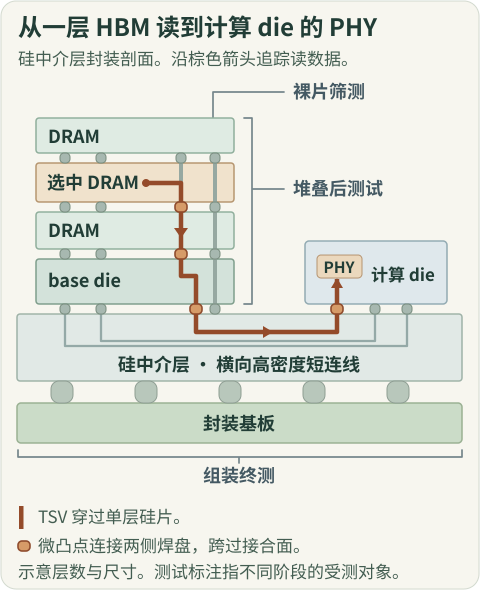

# NPU 该选 HBM 还是 LPDDR？从一笔权重读取算起

假设你在给一颗推理芯片选外存。它要让一个语言模型合计每秒生成 10 个 token。跑第一版程序，每生成一个 token，计算芯片和外存之间合计要传 2 GB；改了权重的使用顺序，同样一个 token 只需要传 1 GB。模型的权重没变，乘法也没少做。原来带宽刚好用尽的内存，现在为什么可能够用了？

先跟一笔具体的读请求走一趟。计算阵列要做乘法，下一块权重还放在外存。如果走 HBM 路线，权重存在哪一片硅上？它怎样到达旁边那颗计算芯片？把这条边界认清，再数整个模型每生成一个 token 有多少字节必须经过这里，才知道给这条路加宽值多少钱。

## 从一层 DRAM 到旁边的计算芯片，中间经过什么？ {#path}

**HBM（High Bandwidth Memory，高带宽内存）**把多片 DRAM 裸片叠成一摞。裸片（die）指从晶圆上切下来的芯片。下面画的是一种具体组合：HBM2E 风格的堆叠位于一侧，计算 die 位于另一侧，两者通过同一片硅中介层连接。图中的计算侧包含控制器和物理接口（PHY）。读请求由计算侧发出，图线跟踪返回的权重数据。

1. **先读出存储单元。** 控制器把权重地址映射到相应的通道、bank、行和列。如果 bank 已经预充、处于空闲状态，要先激活目标行，把单元里的微小信号放大。如果同一 bank 还开着另一行，则须等时序允许，先预充关闭原来的行，再激活目标行。行打开后，才按列取出这次突发传输的数据。堆了多层以后，这些 DRAM 阵列操作仍然要做。[回看 DRAM 怎样开行与选列](../03-dram/foundations/README.md)
2. **沿堆叠向下。** 选中层的 I/O 电路把数据送上堆内互连。硅通孔（TSV）是穿过一片硅的导电连接；走到两片 die 的接合面，还要靠相应的连接结构接到下一片。图示的结构在层间使用微凸点。堆内也有电源和地的垂直连接，图中箭头只追读数据。数据沿这条路径到达底部的 base die，再从面向主机的接口送出。选中哪一层决定数据从哪里出来，不必让其他层的 DRAM 阵列也各读一份。
3. **再横向去计算侧。** 数据从 HBM 一侧进入中介层的细密布线，横向走到计算侧 PHY。控制器接回数据，片上互连或搬运单元还要把它送到能喂给阵列的位置。图底部的封装基板负责把这个组件接到系统。沿图中这笔读数据走，它在中介层就已转向计算芯片，不需要先绕去主板。[Micron HBM2E 技术说明，堆叠和系统封装见图 1、2](https://assets.micron.com/adobe/assets/urn%3Aaaid%3Aaem%3A275edf31-79e3-4b6c-8bbd-a233babe9281/original/as/micron-hbm2e-memory-wp.pdf)

现在可以分别数两个东西了。**增加堆叠层数**，在每层存储组织相同的假设下，能在相近的占板面积内装下更多数据。**增加堆栈对外的数据线**，才会在每线速率相同时提高接口峰值。一摞存储芯片是垂直的 3D 堆叠，堆栈和计算 die 则可以并排做 2.5D 集成。两者可以同时出现在同一封装中。单颗 die 内怎样制造存储单元，又是另一个层次。[DRAM 工艺与堆叠](../03-dram/foundations/dram-process-stacking-trends.md)

图中用整片硅中介层承载横向连线。产品还可以换另一种做法。台积电的 CoWoS-S 使用硅中介层，CoWoS-R 使用由铜走线和聚合物等组成的重布线层（RDL）中介层，CoWoS-L 则在 RDL 中介层中结合局部硅互连。例如，在 Agilex 7 M 系列 FPGA 中，HBM2E 通过 EMIB 硅桥连接含有控制器和 PHY 的接口子系统。读这些剖面时，可以先用手指出堆栈与计算侧之间那一段，再问这一段由谁布线。[台积电 CoWoS 技术说明](https://3dfabric.tsmc.com/english/dedicatedFoundry/technology/cowos.htm) · [Altera Agilex 7 M 系列手册，第 2.1 节](https://docs.altera.com/r/docs/773264/26.1.1/high-bandwidth-memory-hbm2e-interface-agilex-7-m-series-fpga-ip-user-guide/hbm2e-in-agilex-7-m-series-devices)

## 宽接口为什么能多送数据，却未必更早拿到第一个数？ {#width}

假设一条数据线的传输率是 3.2 Gb/s，一摞 HBM 有 1,024 条承载数据的线。所有线都在给读数据服务时，每秒能送出多少字节？

**1,024 × 3.2 Gb/s ÷ 8 = 409.6 GB/s。** 这是单个接口在该方向上的理论峰值，GB 取十进制。每线速率已经计入每秒的传输次数，无须再乘一次 DDR 的双沿系数。Micron 的 HBM2E 资料把这个数取整为 410 GB/s。一个系统如果有多个独立接口，且数据分布和上游通路允许它们同时工作，才可以把相应上界相加。[Micron HBM2E 技术说明，表 1](https://assets.micron.com/adobe/assets/urn%3Aaaid%3Aaem%3A275edf31-79e3-4b6c-8bbd-a233babe9281/original/as/micron-hbm2e-memory-wp.pdf)

回到刚才那块权重。若许多独立请求分布在多个通道，宽接口有机会在同一段时间送回更多字节。若每次必须等到上一笔返回，才知道下一笔读哪个地址，旁边的通道即使闲着，也不能提前发出那笔未知的请求。行冲突、刷新、读写换向、控制器和片上互连还会占去时间。所以 **409.6 GB/s** 可以用来检查接口上界，不能直接拿来承诺一次读取的等待时间，或一个模型持续运行时的带宽。[HBM 的通道与伪通道](../03-dram/protocols/hbm-stacked-wide-io.md) · [峰值与有效带宽](../01-memory-hierarchy/03-performance/effective-bandwidth-vs-peak.md)

LPDDR（Low Power Double Data Rate）也是 DRAM。它在笔记本、移动设备和其他面向能耗的设计中很常见。以 TI Jacinto7 的板级 LPDDR4 路径为例，数据从内存封装引脚经过电路板走线，进入处理器封装和 PHY。系统可以布多条这样的通道；也有移动设备用 PoP，把内存封装叠在处理器封装上。选 LPDDR 时，仍要数实际接了多少通道、每条有多宽、能跑多快。选 HBM 时，封装内的短距离和高密度布线使大量数据线并排连接更可行，但随之而来的供电、散热、信号完整性和机械应力都要验证。比较“带宽密度”还要写出分母，是每毫米芯片边缘，还是每平方毫米封装面积。[TI 的 LPDDR4 板级设计指南](https://www.ti.com/lit/pdf/spracn9) · [移动设备的 PoP 与 MCP](./packaging/pop-mcp-mobile-integration.md)

## 同一笔权重，怎样把 20 GB/s 的需求降到 10 GB/s？ {#budget}

先固定窗口。这里只看 **decode**，即模型已有上下文后逐步生成新 token 的阶段。在同一颗加速器的所有外存接口上，统计窗口内实际要传输的读、写载荷字节总数，除以所有请求合计生成的 token 数。这里的持续供给能力也按同一边界和读写组合比较。多个请求同时服务时，10 token/s 表示合计每秒生成 10 个，不等于每个请求都能得到这个速度。

| 每生成一个 token 的外存流量 | 权重逐次读取 | 一次权重读取供三个输出 token 复用 |
| --- | ---: | ---: |
| 读权重 | 1.5 GB | 0.5 GB |
| 读写 KV cache（各请求已保存的注意力键和值） | 0.4 GB | 0.4 GB |
| 读写激活及其他数据 | 0.1 GB | 0.1 GB |
| 合计 | **2.0 GB/token** | **1.0 GB/token** |

右列是怎样得到的？假设把三个能一起处理的请求编成一批。走到同一层时，刚从外存取回的一块权重先留在片上，三个请求各用它做一次计算，再换下一块。沿整个模型重复这个过程，这一步为三个请求各生成一个 token，共读权重 1.5 GB，平摊就是 **1.5 ÷ 3 = 0.5 GB/token**。各请求仍有自己的上下文。这里特意假设每 token 的 KV 和其他流量不变，才可以只改权重这一行。若缓冲装不下、执行顺序不允许复用，或上下文长度发生变化，就得重新数。[用三个计算块跟踪片上权重的一个更小例子](../01-memory-hierarchy/04-npu-case/npu-memory-hierarchy.md) · [How to Scale Your Model，第 7 章推理带宽模型](https://jax-ml.github.io/scaling-book/inference/)

现在再看服务目标。**所需平均外存带宽 = 聚合生成速度 × 每个输出 token 的外存读写字节数。** 同为 10 token/s，左列要 10 × 2.0 = **20 GB/s**；右列要 10 × 1.0 = **10 GB/s**。加宽接口改变“一秒能送多少”，复用权重改变“一次生成必须送多少”。这两个设计动作作用在同一笔账的两端。若长上下文使 KV 流量成为大头，即使权重完全复用，KV 那一行也还要付。

这张表只算流量。**容量**要另算：在最挤的那一刻，模型权重、所有活跃请求的 KV、计算所需的临时空间和预留空间，一共要驻留多少 GB？同一块权重常驻外存只占一份容量，反复读取它却会多次产生流量。反过来，提高 batch 可以少读权重，也可能让更多请求的 KV 同时驻留。若容量放不下而需要换入换出，新增的传输还要加回表里。

## 哪个候选方案会先失去资格？ {#choose}

假设有两套候选配置。A 接口峰值为 40 GB/s，在本例读写模式下能持续提供 20 GB/s；B 峰值为 100 GB/s，可持续提供 50 GB/s。数字只用于练习选型，与上面那颗 HBM2E 的标称值是两个例子。给真实 LPDDR 或 HBM 方案估算这些指标时，要使用相应通道数、访问形状和温度条件下的测量或经校准的估计。

| 目标与程序 | 需要的外存带宽 | A 可持续 20 GB/s | B 可持续 50 GB/s |
| --- | ---: | --- | --- |
| 10 token/s，每 token 传 2 GB | 20 GB/s | 刚好用尽，无平均余量 | 余 30 GB/s |
| 10 token/s，每 token 传 1 GB | 10 GB/s | 余 10 GB/s | 余 40 GB/s |
| 同样的复用前程序，目标提高到 15 token/s，每 token 仍传 2 GB | 30 GB/s | 缺 10 GB/s | 余 20 GB/s |

第三行特别容易误判。A 的宣传峰值 40 大于需求 30，但这种访问下 A 只能持续供给 20。假设容量充足、其他条件不变，仅这条内存路径就把吞吐限制在 **20 ÷ 2 = 10 token/s** 以内。此时换成可持续带宽更高的配置有明确理由。反过来，若产品目标是第二行，手头的 LPDDR 实现确实测到了 A 的能力，并且容量和响应时间也达标，那么升级 HBM 的理由就不能只写“模型需要更多平均带宽”。若目标是第三行，而可实现的 LPDDR 方案都达不到 30 GB/s，能达到 B 的 HBM 方案才进入下一轮成本与功耗比较。

带宽过了这一关，还要把请求放回时间轴。三路一起用权重，可能要等合批；聚合 token/s 合格时，单个请求仍可能等得太久。给定模型、精度、并发和序列长度，分别测 **prefill**（处理提示词、准备首个输出）和 **decode**，观察首个 token 的等待时间、相邻输出间隔以及慢请求的尾延迟。还要看瓶颈是否已经转到片上 SRAM、互连或计算阵列。NVIDIA 的 Grace 指南就要求按系统配置运行 STREAM 来检查 LPDDR5X 带宽。那是特定 CPU 平台的测试方法，NPU 应用仍要用自己的负载验证。[Grace 带宽测试说明](https://docs.nvidia.com/dccpu/grace-perf-tuning-guide/health-checks.html)

若两套方案都能及时供数，端侧设备还有一个实际问题：两轮推理之间，内存会闲多久？要看候选 LPDDR 器件有哪些能保留所需数据的低功耗状态，进入和退出各需多久。长空闲可能足以省下能量；频繁唤醒则可能增加延迟，甚至抵消节省。对一直繁忙的服务器，应按持续负载测运行功率。两种场景各按自己的工作时间计算整机能量。[LPDDR 的低功耗状态与系统集成](../03-dram/protocols/lpddr-low-power-mobile.md)

## 一摞内存怎样变成一颗合格产品，钱花在哪一步？ {#yield}

再看剖面图。组装前可以先筛裸片，组装成堆后可以测层间连接和堆栈功能，接上计算芯片之后还可以测整个封装。例如检查计算 PHY 发出的测试数据能否穿过封装互连被内存端正确接收。**一片裸片通过筛测，不能提前证明一条还没装上的连接也会通过测试。** 越晚才发现故障，前面已投入而又无法回收的合格组件、工时就越多。图中标出了三个检查对象，实际产品会按测试覆盖、返修能力和成本安排工序。[Micron HBM2E 技术说明，Boundary Scan 与 Loopback Test Modes](https://assets.micron.com/adobe/assets/urn%3Aaaid%3Aaem%3A275edf31-79e3-4b6c-8bbd-a233babe9281/original/as/micron-hbm2e-memory-wp.pdf) · [Intel Foundry 的裸片筛测与组装](https://www.intel.com/content/www/us/en/foundry/packaging.html)

用两个独立的算例看清“良率影响成本”的含义。

- **要凑齐多少个合格组件？** 假设一次装十个未经筛选的组件，每个独立地以 99% 的概率合格，缺一个就判整件失败，也无法修复。十个全合格的概率是 **0.99¹⁰ ≈ 90.4%**。这里的十是教学假设，不能按某款 HBM 的层数把它当作产线良率。筛选、冗余、关联缺陷和返修都会改变结果。
- **花掉的钱由多少个成品分担？** 另假设每次完整组装到终测前都投入 20 个成本单位，终测合格率为 80%，失败品全部报废。做 100 次约花 2,000 个成本单位，长期平均约得到 80 个合格件，折合每个合格件 **20 ÷ 0.8 = 25** 个成本单位。若中途就筛出坏件，它们没有发生后续工序的全部费用，应按到达各阶段的数量分开核算。

从哪一步买入，直接影响这本账。若从晶圆开始算，要计入裸片制造、筛测、报废、堆叠和堆后测试。若购买已筛测的裸片（Known Good Die，KGD），裸片单价已含这一步筛损，之后还要算堆叠、键合和堆后筛测。若直接买入**已测合格的堆栈**，这项采购价已经包含供应商承担的相关成本；再把同一批裸片的原始良率除一次，会把同一损失算两遍。此时应从买入合格堆栈往后算计算 die、中介层或桥、组装测试、残余失效与可返修价值。把这些数从工厂追到整机，还要计入供电、散热与运行能耗，设计验证的一次性支出则要按预计出货量摊销。制造成本、采购报价和整机总成本各有边界；实际比较要记录报价时间、数量和供应条件。[FAB 的 HBM 封装与测试案例](../../chip-development/FAB/wiki/04-back-end-packaging/hbm-as-case-study/README.md)

## 最后怎样在 HBM 与 LPDDR 之间作决定？ {#model}

回到开头的芯片。如果外存供数已决定速度，而且复用之后仍有大量 KV 或权重必须跨接口，就要问：给定板面积和封装条件，哪套内存能持续供足？如果换一种计算顺序就让现有 LPDDR 的带宽有了余量，就要改问：换 HBM 还能改善哪个已测到的瓶颈？下面这几行记录可以让两边在相同条件下回答。

| 记录什么 | 用它检查什么 |
| --- | --- |
| 模型、精度、上下文长度、并发、每阶段峰值驻留量 | 按可寻址且可用的容量核算，留足冗余与预留空间后能否放下工作集；若需换入换出，要重算流量预算 |
| 同一窗口的读写字节、输出 token 数、时限与尾延迟 | 接口在真实访问下是否供得上，平均值是否掩盖短时拥塞 |
| 实际接口和堆栈数、控制器、共享片上路径及测得的持续能力 | 额外的接口宽度能不能一路用到计算阵列 |
| 同一工作负载、同一测量范围的运行与空闲功耗、运行时间 | DRAM、PHY、控制器以及系统消耗多少能量，以及运行功率是否超过产品供电和散热上限。用同一窗口内的总能量除以输出 token 数得到能量/token。单个数据引脚的 pJ/bit 只覆盖其中一部分 |
| 满足上述约束所需的器件数、封装、供电、散热、测试、采购与维护条件 | 对齐服务目标和可靠性要求后，比较整机成本。无法量化的风险分别记下，避免把货币、功耗和主观评分直接相加 |

## 接下来怎么读 {#next}

想追三个计算任务为什么只需从外存读一次相同的权重，可以回看[片上权重复用](../01-memory-hierarchy/04-npu-case/npu-memory-hierarchy.md)。若想换一个条件，让权重留在 HBM 的 bank 旁做乘法，再问哪几笔输入和结果仍须走出堆栈，接着读[存储扩展与近存计算中的部分和实例](./future-packaging-cxl-near-memory.md#hbm-pim-data-path)。这里改变了计算的位置，可以用本文同一条接口边界重新数一遍字节。
