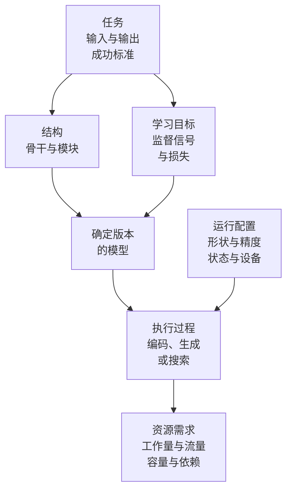

# 概念关系图：任务、结构、目标与执行不是同一层

上级：[专题导读](README.md)

同一个名称可能描述任务，也可能描述模块或训练方式。先把问题分层，再看它们如何组合，可以避免把“CNN、对比学习、VLA、世界模型”排成互斥算法。

## 一张组合图

图中箭头表示设计与分析关系，不表示训练和推理一定按此时间顺序运行。

## 三个具体组合

目标检测可以使用 CNN 骨干和集合预测头，训练时使用匹配损失。匹配属于训练职责，不自动进入部署。

VLA 可以使用视觉语言骨干，从示范动作构造 Flow Matching 的速度目标来训练连续动作头。执行时，求解器在不同时间点调用动作头，逐步生成动作块。示范提供数据，损失规定目标，求解器规定运行时的调用顺序。

BEVWorld 以 BEV latent 组织场景，用序列 diffusion 预测未来，再解码观测。BEV 与 latent 是表示属性，diffusion 是生成机制，视频是输出之一。

## 从概念走到计量

只有确定模型版本、执行阶段与输入形状后，才能估算资源。参数量没有说明激活峰值，FLOPs 没有说明内存流量，生成长度没有说明 NFE。

继续阅读[张量与成本](tensor-shapes-and-cost.md)及[工作负载分析方法](../06-chip-workload-analysis/workload-analysis-methodology.md)。需要反查缩写时使用[术语表](glossary.md)。
