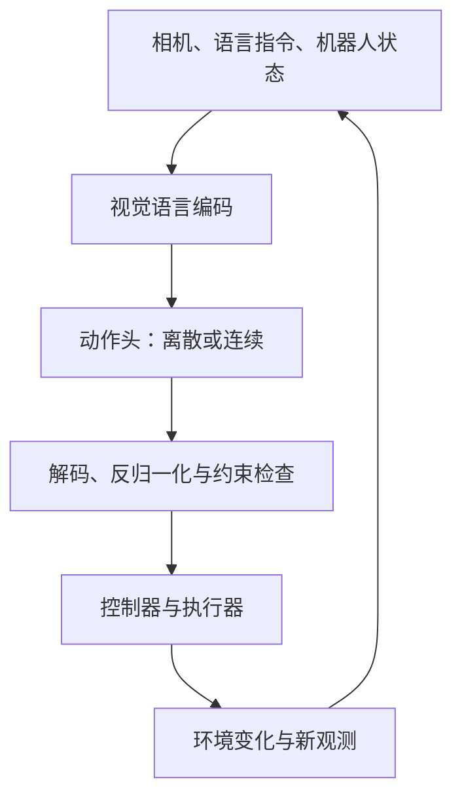

# VLA 基础：把视觉与语言条件转成可执行动作

上级：[专题导读](README.md)

视觉语言动作模型（VLA）根据视觉、语言和可选的机器人状态预测动作。它的输出必须连接明确的执行接口；会描述动作的 VLM 还不自动具备控制机器人所需的动作能力。

## 一条完整的执行路径

视觉编码器提取图像特征，语言部分表达任务条件，动作头产生单步动作或动作序列。状态输入是否包含关节、末端位姿等信息，取决于具体模型，不能一概而论。

## 动作输出需要明确什么

至少写出坐标系、单位、维数、绝对值/增量、归一化方式和控制周期。末端动作还需要控制器或逆运动学转为可执行命令；关节目标也不等于直接输出电机力矩。

构造例：7 维输出可由三维平移、三维旋转和夹爪组成。旋转是欧拉角、轴角还是其他表示，夹爪是连续开度还是离散状态，都影响解码与误差。不能把“7 维”直接写成“七自由度机械臂”。

## 两类动作生成机制

离散动作模型把连续值分箱或压缩成 token，再进行分类或自回归预测。连续动作头则直接回归，或用 diffusion/flow matching 生成整段动作。连续头也可用 action token 作为内部序列单元；区别在于是否使用**离散动作词表**。

动作块能表达时间相关性并摊薄编码开销，但执行长度可以短于预测长度。每次只执行一部分，再根据新观测重新生成，是一种滚动执行方式。

## 训练、迁移与评估

训练数据需同时约束观察、指令和动作。预训练视觉语言知识可帮助识别物体与理解任务，却不能替代机器人动作数据及本体适配。相同语言指令在不同末端、夹爪和工作空间中可能对应不同动作分布。

评估应报告任务成功率、试验次数、环境和初始状态、失败定义及执行频率。离线动作预测误差与真实闭环成功率各有用途，不能相互替代。

本章的 [RT](rt-series.md)、[OpenVLA](openvla.md) 和 [GR00T N1](groot.md) 是明确版本的设计案例；[动作表示](action-tokenizer.md)比较生成接口，[VLA 工作负载](../06-chip-workload-analysis/vla-workload.md)负责成本。

## 来源与延伸

- [RT-2](https://arxiv.org/abs/2307.15818)
- [OpenVLA](https://arxiv.org/abs/2406.09246)
- [π0](https://arxiv.org/abs/2410.24164)
