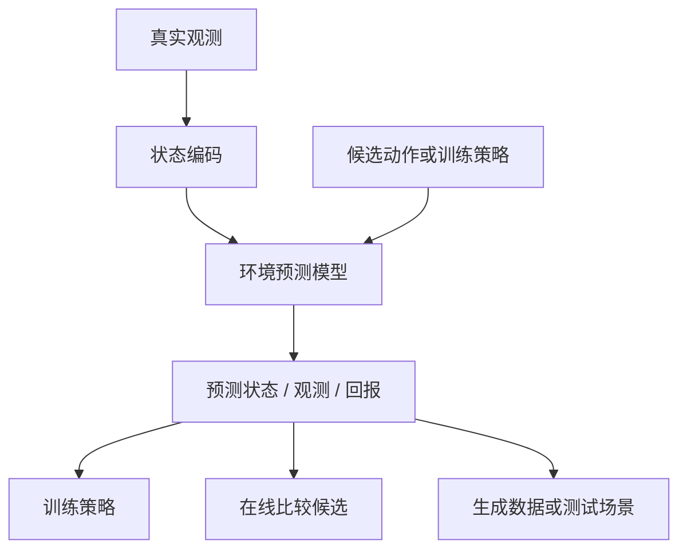

# 世界模型基础：预测什么、由什么条件控制、用于哪里

上级：[专题导读](README.md)

世界模型学习环境的状态或观测如何随时间变化，用于预测、策略学习、规划或生成测试环境。它不是视频生成的同义词，也没有唯一的内部表示。阅读论文时，先写清预测对象、条件、用途和实际调用路径。

## 从部分观测建立状态

智能体通常只能看到传感器观测 $o_t$，不能直接访问完整环境状态。模型可用历史构造内部状态 $z_t$，再预测未来：

$$
z_t=E(o_{\le t},a_{<t}),\qquad
p_\theta(z_{t+1}\mid z_t,a_t)
$$

这是动作条件的一步转移示意，不是所有世界模型的统一实现。模型也可能直接预测多个未来时刻，或预测无动作条件的视频分布。需要比较不同动作后果时，必须明确动作如何进入模型；若没有动作条件，就不能直接把预测解释为候选动作的反事实结果。

## 四个互相独立的分类轴

| 轴 | 要回答的问题 | 示例 |
| --- | --- | --- |
| 表示 | 模型内部怎样组织信息 | 连续 latent、离散 token、BEV、三维网格 |
| 预测机制 | 怎样生成未来 | 递推、自回归、diffusion、flow matching |
| 条件 | 未来依赖哪些可用信息 | 历史观测、动作、导航、目标 |
| 用途与输出 | 谁消费预测，是否解码 | 想象训练、在线规划、图像/点云生成 |

BEVWorld 同时采用 BEV latent、diffusion 和观测解码器。因此“latent、BEV、视频、diffusion”不能排成互斥路线，也不能按这些名称直接排列硬件成本。

## 模型怎样进入决策

三条用途可以独立使用。DreamerV3 在想象轨迹中训练 actor，真实交互由 actor 选动作，不做每步候选搜索。V-JEPA 2-AC 则在部署规划时调用预测器和 CEM。画图时必须保留这类差别。

## 世界模型与视频生成的关系

视频生成可以提供丰富的未来观测，但画面逼真不证明动力学、动作响应和几何一致。相反，只预测 latent 的系统仍可能有效支持策略学习，却不直接给出可视化图像。

判断能否用于某项决策，应检查任务相关预测误差、不同动作下的响应、长时误差累积和闭环结果。模型会预测未来，不等于已经学得完整物理规律。

## 成本沿调用路径展开

逐时刻候选 rollout 可按候选数、时间长度和单步成本估算；整段序列 diffusion 的一次求值可能已经包含全部时间位置，不能再重复乘时间长度。候选可批并行，因此工作量乘法也不等于墙钟时延乘法。

后续分别讨论[视频输出](video-world-model.md)、[BEV](bev-world-model.md)、[占用](occupancy-world-model.md)和 [latent](latent-world-model.md)的接口；成本统一到[世界模型工作负载](../06-chip-workload-analysis/world-model-workload.md)。

## 来源与延伸

- [World Models](https://arxiv.org/abs/1803.10122)
- [DreamerV3 原论文 v2](https://arxiv.org/html/2301.04104v2)
- [BEVWorld 原论文 v3](https://arxiv.org/html/2407.05679v3)
- [V-JEPA 2 / 2-AC 原论文 v1](https://arxiv.org/html/2506.09985v1)
