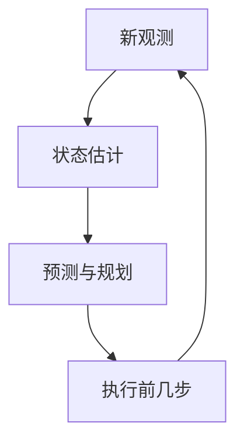

# 预测、规划、策略与控制：从观测到执行的边界

上级：[专题导读](README.md)

预测回答“之后可能发生什么”；规划比较候选行动；策略把可用信息映射为动作；控制器根据反馈跟踪目标并生成设备命令。一个网络可以承担其中多项职责，职责仍需要分别说明。

## 先定义可用信息

环境真实状态通常不能完整观测。图像、速度、关节位置和接触信号只是观测。系统可以使用历史 $o_{\le t}$ 或估计状态 $s_t$ 决策。把一帧图像直接称为完整的 Markov 状态，需要额外假设。

动作也有层次：离散任务指令、未来轨迹、末端位姿增量、关节目标或力矩。比较两个模型前，应先确认它们输出的是哪一层。

## 规划的输入与输出

给定当前状态估计、环境预测、约束与目标，规划器寻找一段动作序列。一种有限时域形式为：

$$
\min_{a_{0:H-1}}\sum_{t=0}^{H-1}c(s_t,a_t)+c_H(s_H),
\qquad s_{t+1}=f(s_t,a_t)
$$

还需添加动作范围、动力学和碰撞等约束。模型 $f$ 可以来自解析动力学或学习；若它有误差，优化得到的低代价轨迹不保证在真实环境中可执行。

## 滚动时域怎样使用反馈

构造例：规划器预测未来 16 步，执行前 4 步，再读取新观测并重新规划。预测时域是 16，执行时域是 4，单步动作间隔另行规定。三者共同决定反馈时效。

若每步间隔为 20 ms，执行 4 步覆盖 80 ms。这个教学设定不等于模型必须每 20 ms 完整运行一次；还要检查计算何时开始、结果何时可用，以及控制器如何处理中间反馈。

## 策略与控制器怎样连接

策略 $\pi(a\mid o_{\le t},g)$ 可以直接预测动作，也可以输出供控制器跟踪的轨迹。高层策略慢一些、低层控制快一些是一种组织方式，具体频率由系统设计决定。

端到端训练并不要求删除所有中间模块。可识别的感知、预测与规划模块仍可联合优化。BEV 是表示方式，行为克隆是学习方式，两者都不决定控制器是否存在。

## 评估必须包含执行条件

离线轨迹误差、碰撞指标、进度、舒适度和任务成功率提供不同证据。闭环还要覆盖观测延迟、执行误差与分布变化。学习到的世界模型可以帮助比较行动，但不能单独作为真实安全证明。

继续阅读[模仿学习与强化学习](imitation-and-reinforcement-learning.md)、[自动驾驶](../03-autonomous-driving-algorithms/README.md)或[机器人策略](../04-robotics-and-vla/README.md)。

## 来源与延伸

- [Diffusion Policy：滚动时域与动作序列](https://diffusion-policy.cs.columbia.edu/)
- [UniAD：围绕规划组织任务](https://arxiv.org/abs/2212.10156)
- [DreamerV3：世界模型中的策略学习](https://arxiv.org/abs/2301.04104)
