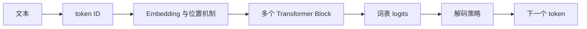

# 语言模型：从 token ID 到下一词元分布

上级：[专题导读](README.md)

语言模型给文本序列分配概率。本文用 decoder-only Transformer 说明一个完整前向过程；编码器语言模型与 encoder-decoder 模型保留在比较中，不把所有语言模型都归为同一结构。

## 完整计算路径

文本经 tokenizer 变成 token ID，embedding 查表得到向量。位置机制与因果注意力共同规定信息如何交互。多个 Transformer block 逐层变换表示，最后通过输出投影得到词表 logits。

词表大小 $V$ 与 hidden size $d$ 决定 embedding 或输出投影的主要形状。某些模型共享输入与输出权重，某些不共享。参数量估算必须按模型配置判断，不能把两张表机械地都算一次。

## 三类结构的不同用途

| 结构 | 信息可见性 | 常见输出 |
| --- | --- | --- |
| Encoder-only | 按掩码双向读取输入 | 分类、检索表示、标注 |
| Decoder-only | 按因果顺序读取上下文 | 后续 token |
| Encoder-decoder | 编码输入，解码器因果生成并读取编码结果 | 翻译等条件序列 |

结构本身不决定最终任务。编码器可以接任务头；生成模型也可以经过指令微调。但是否需要逐 token decode，应由输出接口判断，不能由“Transformer”这个名字判断。

## 训练目标与使用方式

基础预训练学习大规模文本中的条件分布。监督微调使用输入与期望回答；偏好或奖励驱动的训练进一步改变行为。它们可能使用相同的网络，但数据与目标不同。聊天格式、结束 token 和上下文边界也是模型接口的一部分。

构造例：词表只有 A、B、结束三个符号，某步 logits 是 $[2,1,0]$。softmax 约为 $[0.665,0.245,0.090]$。贪心输出 A；采样仍可能选择其他项。生成结果不是把 logits 当作事实置信度直接输出。

## 模型选择怎样改变执行

Llama 3 是包含 GQA 等设计的公开实例。GQA 改变 KV head 数；MoE 改变每个 token 使用哪些专家；滑动窗口改变可见历史。它们都需要在模型配置中明确，不能只记录参数总量。

算法侧说明哪些状态可复用及其大小；运行时决定怎样分配、共享与回收这些状态。继续阅读[自回归生成](../generative-models/autoregressive-generation.md)和 [Transformer 工作负载](../06-chip-workload-analysis/transformer-workload.md)。

## 评估边界

困惑度反映指定文本分布上的概率预测；问答、推理或工具任务需要各自的评价过程。量化、截断上下文和改变解码策略后，应重新检查质量与性能。某个 benchmark 的改善不能直接证明所有场景下更可靠。

## 来源与延伸

- [Attention Is All You Need](https://arxiv.org/abs/1706.03762)
- [The Llama 3 Herd of Models](https://arxiv.org/abs/2407.21783)
