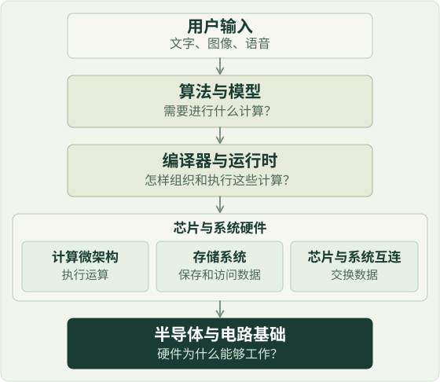

# 第一个字出现之前

你向 AI 提了一个问题，屏幕上的光标还在闪。几秒钟后，第一个字出现了。

在这几秒钟里，计算机做了什么？为什么有时回答很快，有时却需要等待很久？

要回答这些问题，我们需要了解从 AI 模型到芯片内部的一系列技术。

可以先看[一次 AI 推理背后的技术世界](#system-overview)，也可以直接了解[八个系列分别研究什么](#series)、[知识关系](#knowledge-map)和[推荐阅读路径](#reading-paths)。

## 一次 AI 推理背后的技术世界 {#system-overview}

当你输入一个问题，软件首先将文字转换为模型能够处理的数据。模型按照预先设计好的数学结构进行计算，并逐步生成回答。

模型描述了**需要计算什么**，却没有直接规定这些计算应该怎样在一颗具体的芯片上执行。

这就需要编译器和运行时软件。编译器可以在部署模型时把计算转换成硬件能够执行的任务；运行时负责组织这些任务的执行，包括安排计算和管理数据。并不是每次提问都需要重新编译模型。

再往下一层，芯片及其所在的硬件系统有负责运算的计算单元、负责保存数据的存储器，以及负责在不同模块和设备之间传输数据的互连网络。三者相互协作，完成软件交付的任务。

而这些硬件又是由大量晶体管和电路组成的。一次乘法、一次数据读取，最终都依赖于电路中电荷的运动和电压的变化。

<figure class="portal-system-map">
  
  <figcaption>从模型到电路的技术抽象层次，而非实际执行的时间顺序。点击图可查看大图。</figcaption>
</figure>

这些技术并不是彼此独立的。

模型的计算特点会影响芯片的设计，芯片的资源和能力会影响软件的执行方式，而制造工艺、电路时序、功耗和散热又会限制芯片能够达到的性能。

理解一颗 AI 芯片，不仅需要了解每个层次如何工作，还需要了解不同层次之间为什么要这样配合。

## 为什么整理这些笔记

我曾在芯片公司做架构，也做过 AI 编译器和模型部署。

部署模型时，我关心怎样让它在手头的芯片上跑得更快。参与开发芯片模拟器时，我可以在芯片造出来之前比较几种设计，看看哪一种更适合这个模型。

每逢模型跑得比预期慢，我会先问三件事：

**要算多少？要搬多少数据？谁在等谁？**

假设一个计算单元已经算完了手里的数据，下一块权重却还在从显存送来的路上。此时，再增加一个乘法器，也无法缩短这段等待。

那么，为什么不提前搬运数据？提前搬运又需要哪些硬件和软件的支持？可以动手算一遍。[H100 的双缓冲算例](series/chip-architectures/nvidia-h100-sxm/README.md#双缓冲能重叠多少时间)

一个看似简单的性能问题，最终可能涉及模型、编译器、计算单元、存储系统和互连网络。

这就是我整理这些笔记的起点。我希望将这些分散的知识联系起来，不仅了解技术是什么，更理解它为什么存在、怎样工作，以及它如何影响整个系统。

## 八个系列分别研究什么 {#series}

下面按三个阅读问题介绍八个系列。每个系列都可以单独进入，表中的建议基础不是硬性先修要求。

<nav aria-labelledby="series" id="common-foundations">
<!-- site-series -->
</nav>

## 八个系列的知识关系 {#knowledge-map}

理解芯片可以从两个方向出发。

一种是从物理原理出发，逐步理解器件、电路和硬件系统；另一种是从实际计算需求出发，理解算法、软件以及它们需要怎样的硬件支持。

两条路线最终在芯片架构设计和系统执行中相遇。

<figure class="portal-knowledge-map">
  

    
  

  <figcaption>箭头表示主要知识衔接和应用关系，不表示必须完成上游系列才能阅读下游。计算、存储与互连相互影响；工艺、功耗和封装等实现约束也会反过来影响架构选择。窄屏可横向滑动查看全图。</figcaption>
</figure>

## 从哪里读起 {#reading-paths}

你不需要按照固定的顺序读完所有文章。可以根据自己的知识背景和感兴趣的问题选择阅读路径。

| 学习目标 | 推荐阅读路径 |
| --- | --- |
| 从零理解芯片 | [半导体与电路基础](foundations/README.md) → 按兴趣进入[计算微架构](microarchitecture-v2/README.md)、[存储系统](storage.md)或[芯片与系统互连](interconnect.md)。 |
| 理解 AI 模型如何运行 | [算法与模型](external/workload-wiki/README.md) → [推理运行时](series/inference-runtime/README.md)。遇到带宽、延迟、计算利用率问题时，再回到相关硬件系列。 |
| 学习 AI 芯片架构设计 | 结合[算法与模型](external/workload-wiki/README.md)，并行学习[计算微架构](microarchitecture-v2/README.md)、[存储系统](storage.md)与[芯片与系统互连](interconnect.md)，再阅读[芯片架构实例](series/chip-architectures/README.md)。 |
| 了解芯片开发过程 | [芯片开发与实现](series/chip-development/README.md)，按需补充电路与架构等知识。 |

也可以直接从一个具体问题开始。例如，几张 GPU 算完之后都在等同一次求和，可以读[两台服务器上哪块网卡最忙](SCALEUP/wiki/04-software-and-collectives/four-gpu-allreduce-egress.md)这个算例。

这份笔记还会一边学、一边补。我希望和读者一起，从熟悉的现象出发，逐步深入那些不熟悉的技术，直到能够理解现象背后的原理。文中附有我用到的公开资料。哪里理解得不对，欢迎指出来。

