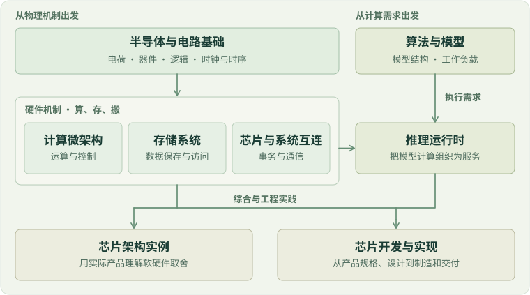

# 第一个字出现之前

你向 AI 提了一个问题，屏幕上的光标还在闪。第一个字出现之前，模型要做哪些计算？这些计算落到芯片上，时间又花在哪里？

可以先看[八个系列的知识关系图](#knowledge-map)，也可以直接[按学习目标选择阅读路径](#reading-paths)。

我曾在芯片公司做架构，也做过 AI 编译器和模型部署。部署模型时，我关心怎样让它在手头的芯片上跑快一点。参与开发芯片模拟器时，我可以在芯片造出来之前比较几种设计，看哪一种更适合这个模型。

每逢模型跑得比预期慢，我会先问三件事。**要算多少？要搬多少数据？谁在等谁？** 假设一个计算单元已经算完了手里的数据，下一块权重却还在从显存送来的路上。再添一个乘法器，眼前这段等待也不会缩短。如果提前搬，能少等多久？可以动手算一遍。[H100 的双缓冲算例](series/chip-architectures/nvidia-h100-sxm/README.md#双缓冲能重叠多少时间)

这就是我整理这些笔记的起点。我把工作中遇到的问题、为弄懂它们翻过的资料和算过的例子放在一起。希望你也能顺着一次等待，从软件追到电路，再回过头来解释屏幕前看到的现象。

## 八个系列的知识关系 {#knowledge-map}

理解一颗 AI 芯片，可以从两头走：从硅里的电荷向上看电路、计算和数据路径；或者从模型的计算需求向下看软件如何利用硬件。两条路在推理系统和芯片设计中相遇。

<figure class="portal-knowledge-map">
  

    
  

  <figcaption>箭头表示主要知识衔接和应用关系，不表示必须完成上游系列才能阅读下游。计算、存储与互连相互影响；工艺、功耗和封装等实现约束也会反过来影响架构选择。窄屏可横向滑动查看全图。</figcaption>
</figure>

## 按学习目标选择阅读路径 {#reading-paths}

| 如果你想…… | 建议从这里读起 |
| --- | --- |
| 从零理解芯片为什么能工作 | [半导体与电路基础](foundations/README.md) → 按兴趣进入[计算微架构](microarchitecture.md)、[存储系统](storage.md)或[芯片与系统互连](interconnect.md)。 |
| 理解大模型怎样计算、怎样部署 | [算法与模型](external/workload-wiki/README.md) → [推理运行时](series/inference-runtime/README.md)。遇到带宽、延迟、计算利用率问题时，再回到相关硬件系列。 |
| 学习 AI 芯片架构、比较设计方案 | 并行学习[计算微架构](microarchitecture.md)、[存储系统](storage.md)与[芯片与系统互连](interconnect.md)，结合模型的计算和数据需求，再阅读[芯片架构实例](series/chip-architectures/README.md)。 |
| 了解一颗芯片如何从规格走到量产 | 从[芯片开发与实现](series/chip-development/README.md)建立完整流程，再根据设计、时序、功耗、封装等问题查阅电路基础和架构知识。 |

也可以直接从一个具体问题开始。例如，几张 GPU 算完之后都在等同一次求和，可以读[两台服务器上哪块网卡最忙](SCALEUP/wiki/04-software-and-collectives/four-gpu-allreduce-egress.md)这个算例。

## 从哪里读起：系列概览 {#series}

下面按三个阅读问题列出八个系列。每个系列都可以单独进入；表中的建议基础是为了帮助理解，不是硬性先修要求。

<nav aria-labelledby="series" id="common-foundations">
<!-- site-series -->
</nav>

这份笔记还会一边学、一边补。文中附有我用到的公开资料。哪里理解得不对，欢迎指出来。

