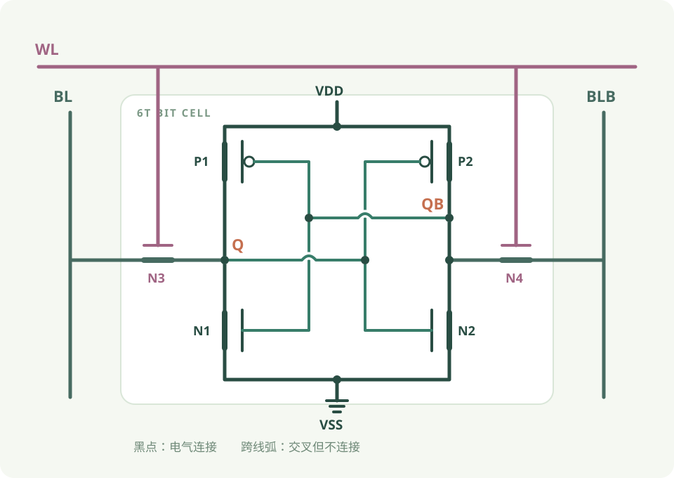

  <section class="hero">
    

      
 芯片微架构笔记 / 系列首页

      <h1>理解芯片， <em>从数据如何 流动开始。</em></h1>
      
从电路与时序出发，理解数据如何存储、计算和移动，再把这些机制转化为可解释的模型。

      

        <a class="hero-button primary" href="../articles/">阅读精选文章 ↗</a>
      

      
01 / 03 电路 <i></i> 架构 <i></i> 建模

    

    

      
      
FIG. 01 芯片中的数据路径 · 概念示意

    

  </section>

  <section class="intro-band">
    
THE NOTEBOOK / 01<h2>从一个问题出发</h2>

    
先弄清输入、资源和约束，再观察数据的路径与完成条件。这里的例子用于帮助理解机制；具体器件的时序与性能仍需要查阅规格并校准。

  </section>

  <section class="explore-section" id="topics">
    

      
EXPLORE THE TOPICS / 02<h2>选择一个专题</h2>

      
从计算与搬运出发， 也可以沿链接阅读存储、互连与制造系列。

    

    

      <a class="topic-card" href="../RAM/wiki/">01 / STORAGE▦<h3>RAM <small>存储系统</small></h3>
从 SRAM、DRAM 单元到存储层级和控制器。
进入专题 ↗</a>
      <a class="topic-card" href="../COMPUTE/wiki/">02 / COMPUTE✳<h3>COMPUTE <small>计算</small></h3>
数据通路、流水线和算力资源如何形成吞吐。
进入专题 ↗</a>
      <a class="topic-card" href="../BUS/wiki/">03 / INTERCONNECT⇄<h3>BUS <small>片上总线</small></h3>
理解事务、握手、仲裁和共享资源。
进入专题 ↗</a>
      <a class="topic-card" href="../NOC/wiki/">04 / NETWORK⌗<h3>NoC <small>片上网络</small></h3>
从 router、流控到拓扑与仿真。
进入专题 ↗</a>
      <a class="topic-card" href="../DMA/wiki/">05 / MOVEMENT↗<h3>DMA <small>数据搬运</small></h3>
描述符、并发与数据搬运的完成边界。
进入专题 ↗</a>
      <a class="topic-card" href="../PCIE/wiki/">06 / HOST LINK⇌<h3>PCIe <small>主机互连</small></h3>
主机与设备之间的链路和事务。
进入专题 ↗</a>
      <a class="topic-card" href="../CIM/wiki/">07 / IN-MEMORY⊞<h3>CIM <small>存内计算</small></h3>
存储阵列、外围电路和计算的边界。
进入专题 ↗</a>
      <a class="topic-card" href="../CPO/wiki/">08 / OPTICAL✺<h3>CPO <small>光互连</small></h3>
光引擎、链路预算与系统集成。
进入专题 ↗</a>
      <a class="topic-card" href="../FAB/wiki/">09 / PHYSICAL◫<h3>FAB <small>制造与封装</small></h3>
工艺、封装、测试与工程约束。
进入专题 ↗</a>
      <a class="topic-card" href="../SERDES/wiki/">10 / SERIAL LINK≋<h3>SerDes <small>高速串行链路</small></h3>
从收发与训练，到设计验证、系统应用和建模。
进入专题 ↗</a>
      <a class="topic-card" href="../HBF/wiki/">11 / FLASH▤<h3>HBF <small>高带宽闪存</small></h3>
从 NAND 读取到近计算存储架构。
进入专题 ↗</a>
    

  </section>

  <section class="reading-section">
    

A GOOD PLACE TO START / 03<h2>推荐阅读</h2>

选一条路径， 沿着问题继续深入。 <a href="../articles/">查看全部精选文章 ↗</a>

    

      <a class="reading-card reading-image" href="../RAM/wiki/02-sram-foundations/6t-cell-bistable-storage/">

RAM · 基础<h3>6T SRAM cell：它如何保存、读取和写入 1 bit</h3>
从存储单元理解保持、读和写。

<b>↗</b></a>
      <a class="reading-card" href="../NOC/wiki/02-router-microarchitecture/credit-based-flow-control/">
NOC · 流控<h3>Credit 如何约束发送？</h3>
从下游 buffer 空位理解局部流控。

<b>↗</b></a>
      <a class="reading-card" href="../DMA/wiki/04-programming-model/tiling-double-buffering/">
DMA · 数据路径<h3>分块与双缓冲</h3>
探索搬运与计算重叠的条件。

<b>↗</b></a>
    

  </section>
  <section class="reading-section" id="on-chip-data-supply">
    

DATA SUPPLY / 04<h2>片上存储与数据供给</h2>

沿一块数据的路径， 从搬运读到存储端口和阵列供数。

    

      <a class="reading-card" href="../DMA/wiki/04-programming-model/tiling-double-buffering/">
01 / DMA<h3>分块与双缓冲</h3>
观察搬运与计算重叠需要满足的条件。

<b>↗</b></a>
      <a class="reading-card" href="../RAM/wiki/02-sram-foundations/single-port-dual-port-multi-port/">
02 / SRAM<h3>单端口、双端口与多端口</h3>
理解一次访问怎样使用存储端口。

<b>↗</b></a>
      <a class="reading-card" href="../COMPUTE/wiki/03-systolic-array/weight-loading-and-trickle-feed/">
03 / ARRAY<h3>权重加载与阵列供数</h3>
继续追踪操作数如何进入计算阵列。

<b>↗</b></a>
    

  </section>

  <section class="reading-section" id="architecture-modeling">
    

MODELING ROUTE / 05<h2>架构建模与性能分析</h2>

先定义工作负载， 再建立模型并检查预测。

    

      <a class="reading-card" href="../external/workload-wiki/06-chip-workload-analysis/workload-analysis-methodology/">
01 / WORKLOAD<h3>工作负载分析方法</h3>
固定输入、阶段、数据量与依赖。

<b>↗</b></a>
      <a class="reading-card" href="../RAM/wiki/06-memory-controller/mc-modeling-for-simulation/">
02 / MODEL<h3>DRAM 控制器建模</h3>
把请求、状态与事件放入同一模型。

<b>↗</b></a>
      <a class="reading-card" href="../NOC/wiki/08-simulator-construction/verification-and-calibration/">
03 / VALIDATE<h3>模型验证与校准</h3>
区分手算检查、参数校准和独立负载验证。

<b>↗</b></a>
    

  </section>
  
芯片微架构笔记READ · THINK · MODEL

